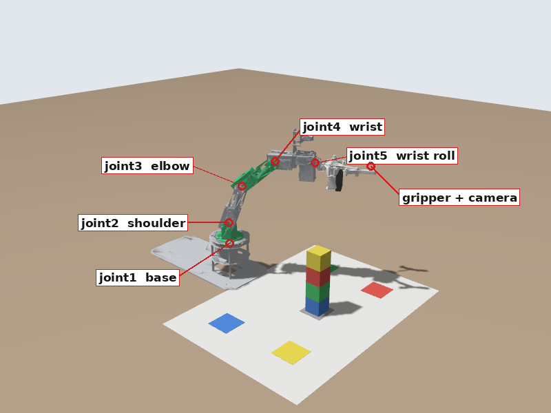
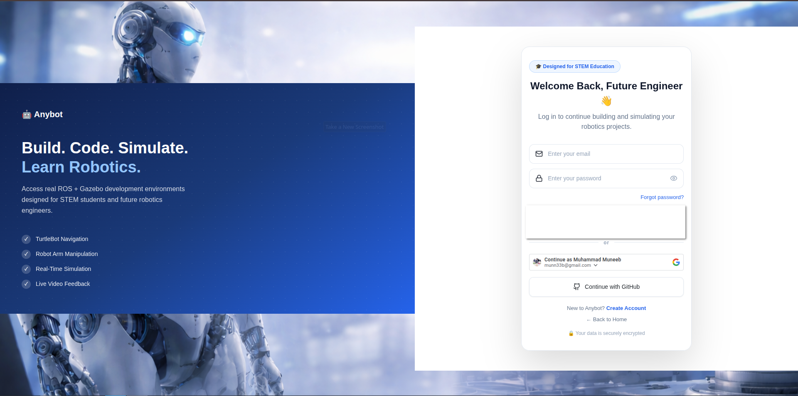
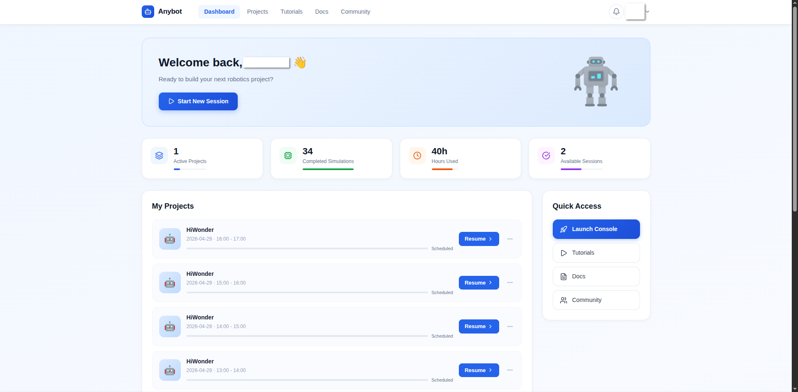
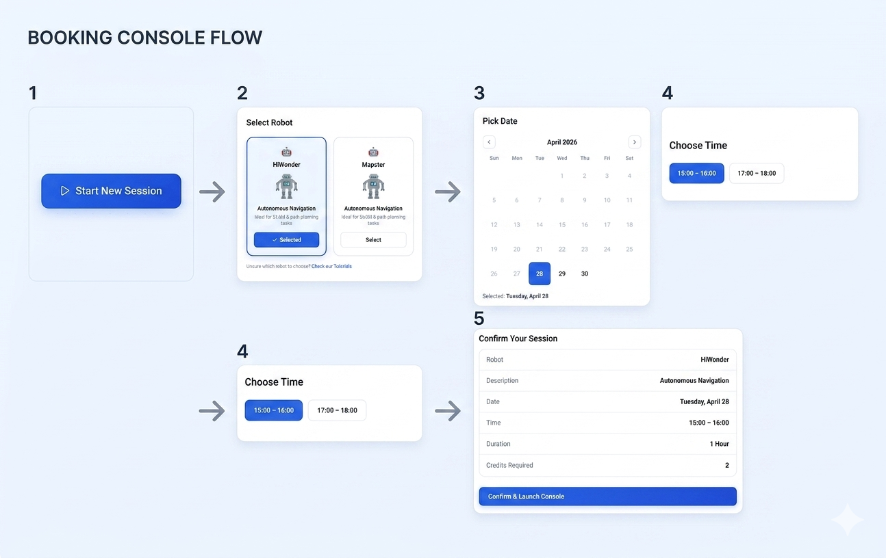
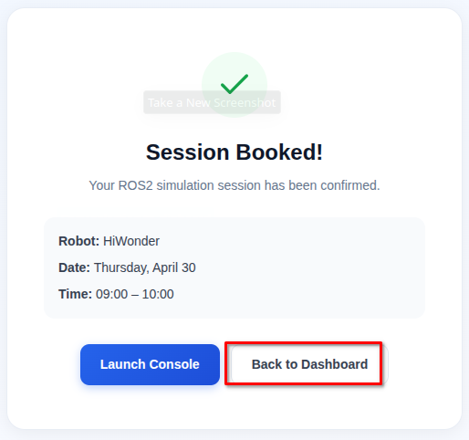
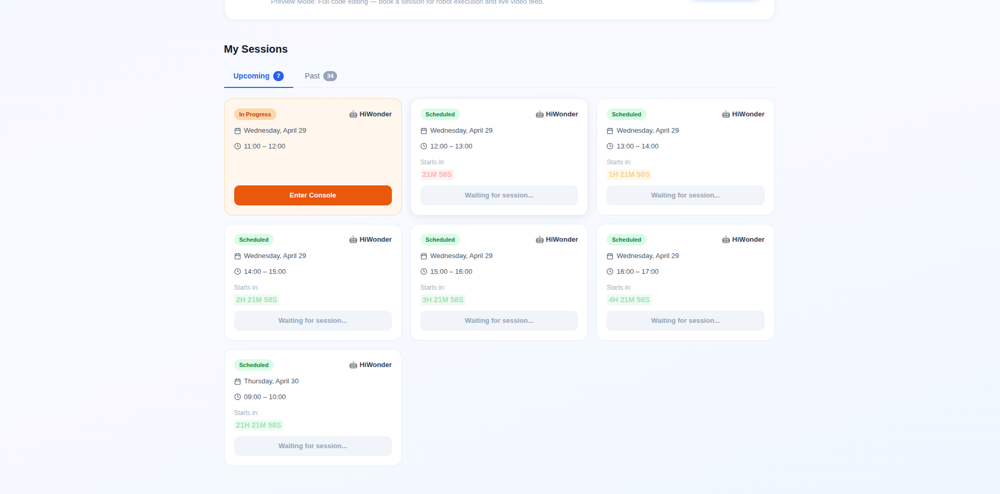
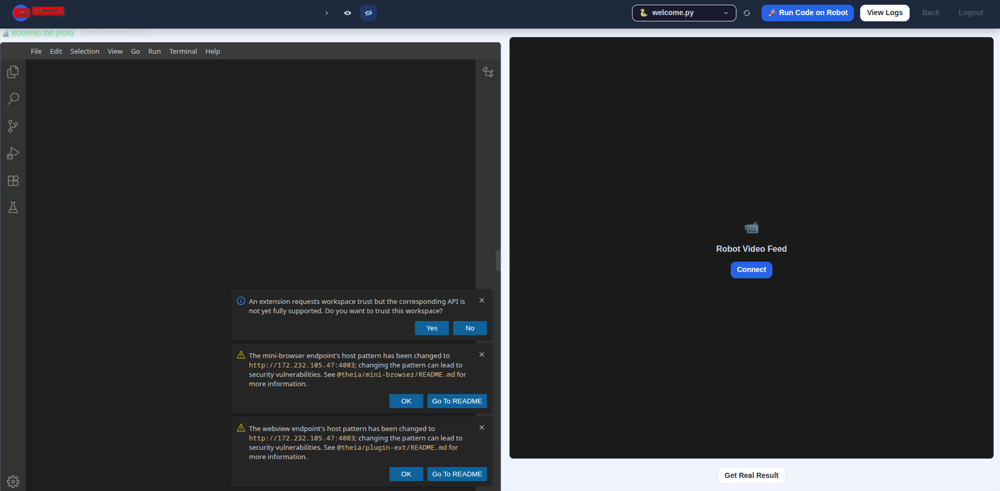
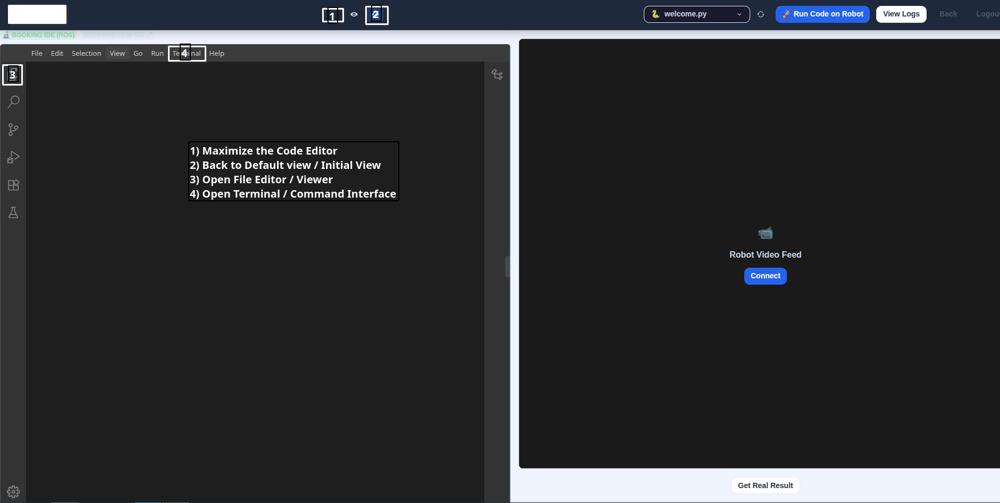
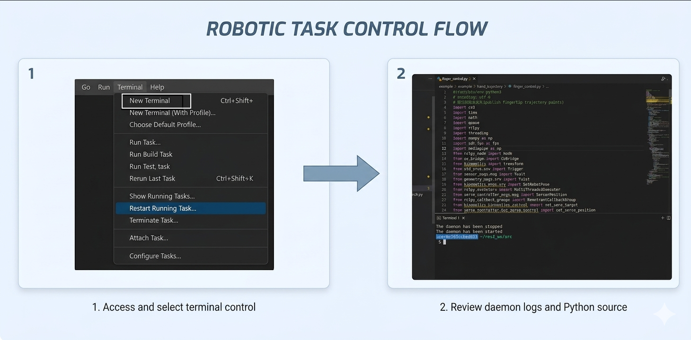
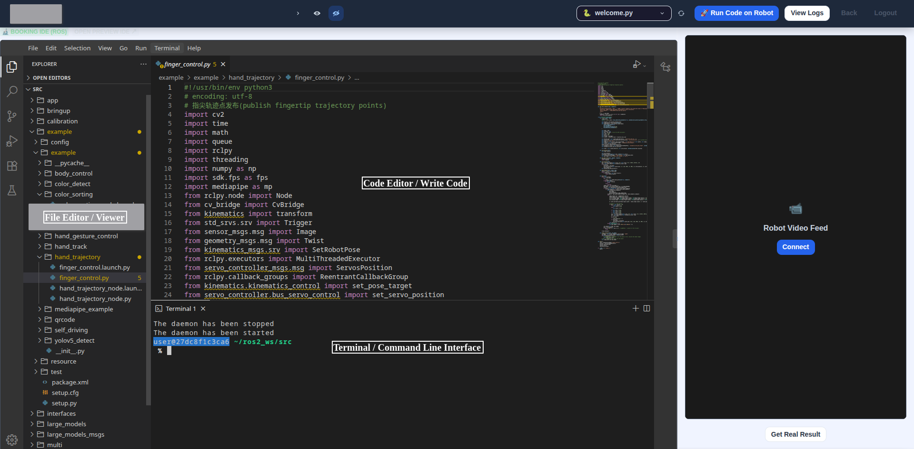

# 🚀 Understanding the Picture (DOFBOT on AnyBot)

📍 **Level:** Absolute beginner
📚 **Topic:** The AnyBot platform, the DOFBOT arm, and how these learning paths work

------

## 👋 Welcome

Welcome to the **DOFBOT learning paths** on **AnyBot**, your robotics lab in the browser.

You will learn **ROS 2**, the software framework most robots are programmed with today, by programming a real robot arm: the **Yahboom DOFBOT**.

With AnyBot you can:

- 💻 Write and run ROS 2 code in your browser, with nothing to install
- 🧪 Test everything on a **simulated** DOFBOT, at any time
- 🦾 Book a slot and run the same code on the **real** DOFBOT in our lab

------

## 🦾 Meet the DOFBOT

The DOFBOT is a small robot arm with **5 joints**, a **gripper** and a **camera**. A Raspberry Pi in its base runs ROS 2.



| Part | ROS 2 name | What it does |
|---|---|---|
| Base | `joint1` | Turns the whole arm left and right |
| Shoulder | `joint2` | Leans the arm forward and back |
| Elbow | `joint3` | Bends the middle of the arm |
| Wrist | `joint4` | Tilts the gripper up and down |
| Wrist roll | `joint5` | Turns the gripper around its own axis |
| Gripper | `finger_left_joint` | Opens and closes the two fingers |
| Camera | `/camera/image_raw` | Looks along the gripper, at whatever the arm points at |

In front of the arm is a **colour mat** with a red, yellow, green and blue square, and a stack of four coloured blocks on the grey square in the middle. By the end of the Simulation path, your own program will look at that stack with the camera and sort the blocks onto their colour squares.

------

## 🧭 Two Learning Paths

| | Part 1 - Simulation | Part 2 - Real Hardware |
|---|---|---|
| Robot | A simulated DOFBOT in your own console | The real DOFBOT in our lab |
| When | Any time, in your **preview session** | During a **booked session** |
| What you learn | ROS 2 from zero: topics, nodes, messages, services, actions, C++, the camera | How to run your code safely on real servos and a real camera |

The simulator runs the **same controllers** as the real arm and uses the **same topic and action names**. Code that works in simulation runs on the real arm without changes. That is why you always build and test in simulation first, and use your short booked slot only to run code that already works.

```
Part 1: write code -> test it on the simulator (any time)
Part 2: book a slot -> run the same code on the real arm
```

------

## 🔑 Step 1: Log in to AnyBot

Log in with your account. You will land on your dashboard.





------

## 🖥️ Step 2: Your Two Kinds of Session

| Session | What it gives you |
|---|---|
| **Preview session** | Always available. Your own console with an editor, a terminal and ROS 2. No real robot, but the **DOFBOT simulator** runs here. Part 1 happens here. |
| **Booked session** | Available during a slot you reserve. The same console and the same files, plus a live connection to the real DOFBOT. Part 2 happens here. |

Your files live in your personal workspace and stay there between sessions. Closing the browser does not delete your work, and the code you write in a preview session is waiting for you in your booked session.

------

## 📅 Step 3: Booking the Real Arm (for Part 2)

You don't need a booking for Part 1. When you reach Part 2, book a slot like this:

```
Start New Session -> Select Robot (DOFBOT) -> Select Date -> Select Time -> Confirm
```



`Note: the screenshots show other robots in the list. Choose the DOFBOT.`

After booking, go back to the dashboard and open **Projects**. Your upcoming sessions are listed at the bottom, and **Enter Console** becomes active when your slot starts.





------

## 👋 Step 4: The Robot Development Console (RDC)

Whether you are in a preview or a booked session, you work in the **Robot Development Console**, or **RDC**. It looks like this when it opens:



You can resize the panels and open what you need:



Open a terminal from the menu with **Terminal > New Terminal**:



The console has three parts you will use all the time:



- **File Explorer** (left): your files and folders. Click a file to open it.
- **Code Editor** (middle): where you write code.
- **Terminal** (bottom): where you type commands. When a module says "run", it means "type this in a terminal and press Enter".

`Note: you can open several terminals at once with the + button. Many modules use two: one for the simulator and one for your commands.`

------

## 📁 Step 5: What Is in Your Workspace

The file explorer shows your ROS 2 workspace, `~/dofbot_ws/src`. It already contains:

| Folder | What it is |
|---|---|
| `dofbot_lab` | Lab tools: starts the simulator, takes pictures, resets the blocks, stops the arm |
| `exercise_1_publisher` ... `exercise_8_block_sorter` | Finished versions of the programs you will write, one per module. Use them to compare with yours if you get stuck. |
| `Practical_Session_2` | Handouts and the starter package for the practical sessions |

You will create your own package next to these in module 5.

------

## ⚠️ One Rule for the Whole Course

`Never type a command you don't understand while connected to the real arm.`

In simulation, a mistake costs nothing: you restart the simulator. On the real arm, a mistake can knock the arm into the table. That is why Part 1 comes first, and why Part 2 starts with safety.

------

## 🏁 What You Learned

- AnyBot gives you a ROS 2 console in the browser, with nothing to install
- The DOFBOT has 5 joints, a gripper and a camera
- Part 1 runs on a simulator in your preview session; Part 2 runs on the real arm in a booked session
- The same code works on both

------

## 🚀 What's Next?

Before touching the robot, you will learn the handful of Linux commands you need to find your way around the terminal.
