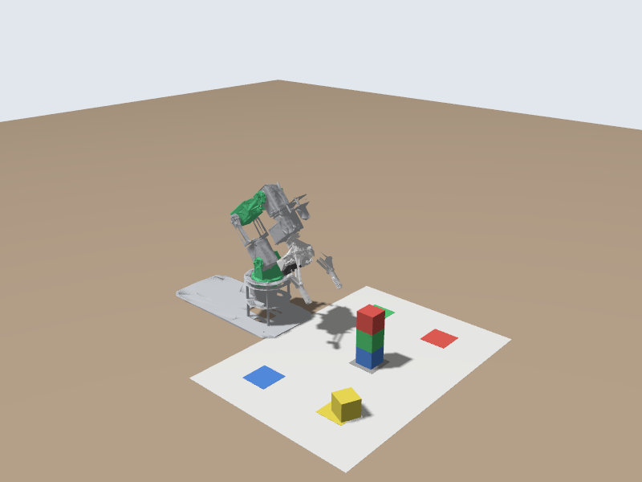

# 🎯 Actions: Pick Up a Block and Put It Down

📍 **Level:** Intermediate
📚 **Topic:** Action clients, goals, feedback and results, with the arm and gripper controllers

------

## 🧠 Why Actions?

Picking up a block is a **sequence**: open the gripper, move above the block, move down, close, lift, move to the target, open. Each step must **finish** before the next one starts. Closing the gripper while the arm is still on its way would grab air.

With topics you can only guess how long to wait. An **action** tells you:

| Part | Direction | Example |
|---|---|---|
| **Goal** | you → controller | "move the joints to these angles in 1.5 s" |
| **Feedback** | controller → you, while it runs | "this is where the joints are now" |
| **Result** | controller → you, at the end | "done: SUCCESSFUL" (or an error) |

The DOFBOT's controllers offer two actions:

```
ros2 action list -t
```

```
/arm_controller/follow_joint_trajectory [control_msgs/action/FollowJointTrajectory]
/gripper_controller/gripper_cmd [control_msgs/action/GripperCommand]
```

------

## 🎯 Your Goal

Take the **top block** (yellow) off the stack and put it on the **yellow square**.



`Start from a fresh stack: ros2 run dofbot_bringup dofbot_cmd home, then ros2 run dofbot_lab reset_blocks.py`

------

## 📍 The Poses

Yahboom measured the poses for this mat on the real DOFBOT, as **servo angles** in degrees (servos 1 to 5, 90 = straight). You will use them as they are and convert them to radians in code:

```
radians = (servo_degrees - 90) * pi / 180
```

| Pose | Servo angles | Where the gripper is |
|---|---|---|
| `READY` | `[90, 130, 0, 0, 90]` | Camera looking at the mat |
| `ABOVE_STACK` | `[90, 80, 50, 50, 270]` | High above the stack |
| `PICK_TOP` | `[90, 72, 49, 13, 270]` | Around the top block of a 4-block stack |
| `PLACE_YELLOW` | `[65, 22, 64, 56, 270]` | Just above the yellow square |
| `LIFT_YELLOW` | `[65, 90, 90, 90, 270]` | Straight up over the yellow square |

Servo 5 at 270 turns the gripper so its fingers line up with the block's sides.

| Gripper | Opening (m) | Servo 6 |
|---|---|---|
| `GRIPPER_OPEN` | 0.0325 | 60° |
| `GRIPPER_BLOCK` | 0.0122 | 135°: squeezing a 3 cm block |

------

## 📄 Step 1: The Code

Create `my_dofbot/scripts/pick_and_place.py`:

```
#!/usr/bin/env python3
"""Take the top block off the stack and put it on the yellow square, with actions."""
import math

import rclpy
from builtin_interfaces.msg import Duration
from control_msgs.action import FollowJointTrajectory, GripperCommand
from rclpy.action import ActionClient
from rclpy.node import Node
from trajectory_msgs.msg import JointTrajectoryPoint

JOINTS = ['joint1', 'joint2', 'joint3', 'joint4', 'joint5']

# Poses as Yahboom's servo angles in degrees (90 = straight), servos 1-5.
# These are Yahboom's own poses for its colour mat, so they work on the real arm too.
READY = [90, 130, 0, 0, 90]
ABOVE_STACK = [90, 80, 50, 50, 270]
PICK_TOP = [90, 72, 49, 13, 270]       # gripper around the top block of a 4-block stack
PLACE_YELLOW = [65, 22, 64, 56, 270]   # gripper just above the yellow square
LIFT_YELLOW = [65, 90, 90, 90, 270]    # straight up over the yellow square

# Gripper opening: distance of each finger from the centre, in metres.
GRIPPER_OPEN = 0.0325   # fully open (servo 6 at 60 degrees)
GRIPPER_BLOCK = 0.0122  # closed on a 3 cm block (servo 6 at 135 degrees)


def servos_to_radians(servo_degrees):
    """Yahboom servo angle (0-180, 90 = straight) -> ROS joint angle in radians (0 = straight)."""
    return [math.radians(d - 90.0) for d in servo_degrees]


class PickAndPlace(Node):
    def __init__(self):
        super().__init__('pick_and_place')
        self.arm = ActionClient(self, FollowJointTrajectory, '/arm_controller/follow_joint_trajectory')
        self.gripper = ActionClient(self, GripperCommand, '/gripper_controller/gripper_cmd')
        self.last_progress = -1

    def wait_for_controllers(self):
        for client, name in [(self.arm, 'arm'), (self.gripper, 'gripper')]:
            if not client.wait_for_server(timeout_sec=10.0):
                self.get_logger().error(f'The {name} controller is not running. Is the simulator (or robot) on?')
                return False
        return True

    def run_goal(self, client, goal, feedback_callback=None):
        """Send a goal, wait until it is accepted, then wait for its result."""
        send_future = client.send_goal_async(goal, feedback_callback=feedback_callback)
        rclpy.spin_until_future_complete(self, send_future)
        goal_handle = send_future.result()
        if not goal_handle.accepted:
            self.get_logger().error('Goal rejected')
            return None
        result_future = goal_handle.get_result_async()
        rclpy.spin_until_future_complete(self, result_future)
        return result_future.result().result

    def move_arm(self, servo_degrees, seconds=1.5):
        goal = FollowJointTrajectory.Goal()
        goal.trajectory.joint_names = JOINTS
        point = JointTrajectoryPoint()
        point.positions = servos_to_radians(servo_degrees)
        point.time_from_start = Duration(sec=int(seconds), nanosec=int(seconds % 1 * 1e9))
        goal.trajectory.points = [point]

        self.goal_seconds = seconds
        self.last_progress = -1
        result = self.run_goal(self.arm, goal, self.on_arm_feedback)
        if result is None or result.error_code != FollowJointTrajectory.Result.SUCCESSFUL:
            self.get_logger().error(f'Arm move failed: {result.error_string if result else "rejected"}')
            return False
        return True

    def on_arm_feedback(self, feedback_msg):
        # Feedback arrives many times a second while the arm moves. Report every 25 %.
        elapsed = feedback_msg.feedback.desired.time_from_start
        progress = int(100 * (elapsed.sec + elapsed.nanosec / 1e9) / self.goal_seconds) // 25 * 25
        if progress != self.last_progress:
            self.last_progress = progress
            self.get_logger().info(f'  arm {min(progress, 100)} %')

    def set_gripper(self, opening):
        goal = GripperCommand.Goal()
        goal.command.position = opening
        goal.command.max_effort = 10.0
        result = self.run_goal(self.gripper, goal)
        # When the fingers stop on a block before reaching `opening`, the
        # controller reports stalled=True. That is what a good grasp looks like.
        return result is not None

    def run(self):
        # Each step is (what it does, the call that does it). lambda: delays the
        # call until the loop below reaches that step.
        steps = [
            ('open the gripper', lambda: self.set_gripper(GRIPPER_OPEN)),
            ('go to the ready pose', lambda: self.move_arm(READY, 2.0)),
            ('move above the stack', lambda: self.move_arm(ABOVE_STACK)),
            ('reach the top block', lambda: self.move_arm(PICK_TOP)),
            ('close the gripper on it', lambda: self.set_gripper(GRIPPER_BLOCK)),
            ('lift it', lambda: self.move_arm(ABOVE_STACK)),
            ('lower it onto the yellow square', lambda: self.move_arm(PLACE_YELLOW)),
            ('let go', lambda: self.set_gripper(GRIPPER_OPEN)),
            ('lift clear', lambda: self.move_arm(LIFT_YELLOW)),
            ('back to ready', lambda: self.move_arm(READY, 2.0)),
        ]
        for number, (what, action) in enumerate(steps, start=1):
            self.get_logger().info(f'Step {number}/{len(steps)}: {what}')
            if not action():
                self.get_logger().error('Stopping here.')
                return False
        self.get_logger().info('Done')
        return True


def main(args=None):
    rclpy.init(args=args)
    node = PickAndPlace()
    if node.wait_for_controllers():
        node.run()
    node.destroy_node()
    rclpy.try_shutdown()


if __name__ == '__main__':
    main()
```

------

## 🧠 Step 2: Understand the Code

### 🎯 Action clients

```
self.arm = ActionClient(self, FollowJointTrajectory, '/arm_controller/follow_joint_trajectory')
self.gripper = ActionClient(self, GripperCommand, '/gripper_controller/gripper_cmd')
```

One client per action: the **action type** and the **action name**, exactly as `ros2 action list -t` printed them.

### 📨 Sending a goal and waiting for the result

```
send_future = client.send_goal_async(goal, feedback_callback=feedback_callback)
rclpy.spin_until_future_complete(self, send_future)
goal_handle = send_future.result()
...
result_future = goal_handle.get_result_async()
rclpy.spin_until_future_complete(self, result_future)
return result_future.result().result
```

An action answers in two stages, so there are two waits:

1. **Accepted?** The controller checks the goal (are the joint names right? is the trajectory valid?) and accepts or rejects it.
2. **Result.** When the move ends, the result says how it went. For the arm, `error_code == SUCCESSFUL` (0) means the joints arrived on time.

`spin_until_future_complete` keeps the node working (and delivering feedback) while it waits.

### 📈 Feedback

```
def on_arm_feedback(self, feedback_msg):
    elapsed = feedback_msg.feedback.desired.time_from_start
```

While the arm moves, the controller sends feedback many times a second: where the joints should be, where they are, and how far along the trajectory it is. The node prints progress every 25 %.

### ✋ The gripper

```
goal.command.position = opening     # metres from the centre to each finger
goal.command.max_effort = 10.0      # how hard to squeeze
```

When the fingers close on a block they stop before reaching `GRIPPER_BLOCK`. The controller notices they've stopped and finishes with `stalled = True`: a sign that something is in the gripper.

### 🪜 A list of steps

```
steps = [('open the gripper', lambda: self.set_gripper(GRIPPER_OPEN)), ...]
for number, (what, action) in enumerate(steps, start=1):
    if not action():
        ...stop
```

Each step is a short description and a `lambda`: a small function that makes the call when the loop reaches it. If any step fails, the loop stops: the arm never tries to place a block it failed to pick.

------

## ▶️ Step 3: Run It

Add `scripts/pick_and_place.py` to `install(PROGRAMS ...)`, `chmod +x`, build and source. Reset the blocks, then run:

```
ros2 run dofbot_bringup dofbot_cmd home
ros2 run dofbot_lab reset_blocks.py
ros2 run my_dofbot pick_and_place.py
```

```
[INFO] [pick_and_place]: Step 1/10: open the gripper
[INFO] [pick_and_place]: Step 2/10: go to the ready pose
[INFO] [pick_and_place]:   arm 0 %
[INFO] [pick_and_place]:   arm 25 %
[INFO] [pick_and_place]:   arm 50 %
[INFO] [pick_and_place]:   arm 75 %
[INFO] [pick_and_place]:   arm 100 %
[INFO] [pick_and_place]: Step 3/10: move above the stack
...
[INFO] [pick_and_place]: Step 10/10: back to ready
[INFO] [pick_and_place]: Done
```

Take a snapshot: the yellow block is on the yellow square.

`Stuck? Build and run the finished version: colcon build --packages-select exercise_5_action, source, ros2 run exercise_5_action pick_and_place.py`

------

## 🧪 Try It Yourself

### 🟢 Easy

- Make every move slower (2.5 s). Does the result change?
- Print the result of the gripper action: `result.position`, `result.stalled`, `result.reached_goal`. What does it say with a block, and when you close it on nothing?

### 🟡 Medium

- After the yellow block, move the **red** one (now on top) to the red square. Yahboom's poses: pick `[90, 66, 43, 20, 270]` (the third level of the stack), place `[117, 19, 66, 56, 270]`, lift `[117, 90, 90, 90, 270]`.

### 🔴 Challenge

- Use the gripper result to detect a **miss**: if the fingers closed all the way (`reached_goal` is true) there is nothing between them. Then stop with an error instead of carrying air to the square. Test it by running the program twice without resetting the blocks.
- Cancel a goal: send a slow arm goal (5 s) and cancel it after 1 s with `goal_handle.cancel_goal_async()`. Where does the arm stop?

------

## ⚠️ Common Mistakes

| Problem | Cause |
|---|---|
| `The arm controller is not running` | Simulator not started |
| `Goal rejected` | Usually a wrong joint name or a different number of names and positions |
| `Arm move failed: ... goal_time_tolerance` | The arm couldn't get there in time: something blocked it, or the time was too short |
| The gripper closes but the block stays behind | The arm wasn't where the block is: the stack was knocked over or not reset. Run `reset_blocks.py` |
| Everything is slow to start | Normal: the first goal waits for the action servers to be found |

------

## 🎯 What You Learned

- An **action** has a goal, feedback and a result, and the client can wait for the result
- `send_goal_async` → accepted? → `get_result_async` → result
- The arm's `FollowJointTrajectory` result tells you whether the move succeeded; the gripper's `GripperCommand` result tells you whether it stalled on something
- Sequences of robot moves are built from steps that each wait for the previous one

------

## 🚀 What's Next?

You have written everything in Python so far. Many robot programs, including the controllers you are talking to, are written in **C++**. Next you will write your first C++ node.
