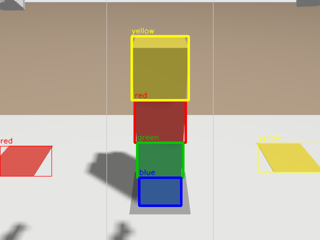
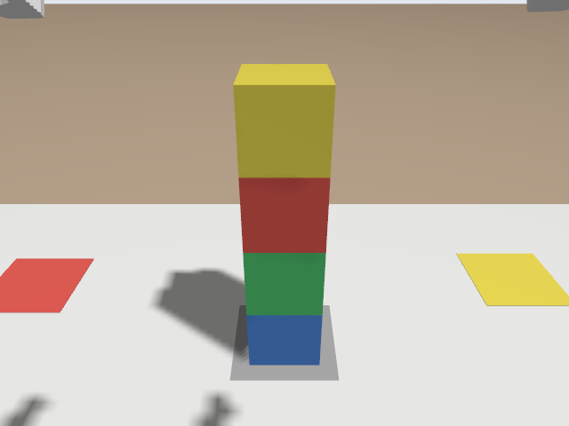

# 📷 The Camera: Finding Coloured Blocks

📍 **Level:** Intermediate
📚 **Topic:** Image topics, cv_bridge, OpenCV colour detection

------

## 🧠 What You Will Build

The DOFBOT has a camera near its gripper. In this module you write a node that:

1. Subscribes to the camera
2. Converts each ROS image into an OpenCV picture
3. Finds the red, yellow, green and blue blocks by their colour
4. Publishes the colours of the stack, top to bottom, on `/block_colors`
5. Saves a picture with the blocks marked, so you can check what it found



This is the "eyes" part of the capstone in the next module.

------

## 📡 1. The Camera Topic

```
ros2 topic list | grep camera
ros2 topic info /camera/image_raw
```

```
/camera/camera_info
/camera/image_raw
Type: sensor_msgs/msg/Image
```

```
ros2 topic hz /camera/image_raw
```

In the simulator the camera delivers 5 to 10 pictures a second, depending on how busy the computer is (the real one, 30).

A `sensor_msgs/msg/Image` is a picture as a long list of bytes, plus its `width`, `height` and `encoding` (the order of the colour bytes, e.g. `rgb8`). **cv_bridge** converts it into an OpenCV picture (a NumPy array) and back.

------

## 👀 2. Point the Camera at the Stack

The `look` pose aims the camera at the stack from the side. Use your service from module 9:

```
ros2 run my_dofbot named_pose_server.py
```

and in another terminal:

```
ros2 run my_dofbot named_pose_client.py look
ros2 run dofbot_lab snapshot.py /camera/image_raw
```

(Without the service: `ros2 run dofbot_bringup dofbot_cmd servos 90 135 15 0 90` is the same pose.)

Open `snapshots/camera.png`:



All four blocks, and parts of the red and yellow squares on the sides. Stop the pose server with `Ctrl + C`.

------

## 🎨 3. Finding a Colour: HSV

A camera gives each pixel as **blue, green, red** amounts (OpenCV's order is BGR). The same yellow block gives very different BGR numbers in light and in shadow, so finding "yellow" in BGR is hard.

**HSV** describes a colour as:

| | Meaning | OpenCV range |
|---|---|---|
| **H**ue | Which colour: red, yellow, green, blue... | 0 to 180 |
| **S**aturation | How strong the colour is (0 = grey) | 0 to 255 |
| **V**alue | How bright | 0 to 255 |

A shadow mostly changes V; the hue stays. So "yellow" is simply "H between 20 and 35, S and V not too low":

| Colour | H | S | V |
|---|---|---|---|
| red | 0-8 **and** 170-180 (red wraps around 0) | ≥ 120 | ≥ 70 |
| yellow | 20-35 | ≥ 120 | ≥ 100 |
| green | 40-85 | ≥ 80 | ≥ 50 |
| blue | 95-130 | ≥ 120 | ≥ 50 |

`cv2.inRange` turns a picture into a **mask**: white where the pixel is in the range, black elsewhere. `cv2.findContours` then finds the white blobs, and `cv2.boundingRect` gives each blob's box.

------

## 📄 4. The Code

Create `my_dofbot/scripts/color_detector.py`:

```
#!/usr/bin/env python3
"""Find the coloured blocks in the arm camera's picture and publish the stack's colours."""
import os
import time

import cv2
import numpy as np
import rclpy
from cv_bridge import CvBridge
from rclpy.node import Node
from rclpy.qos import qos_profile_sensor_data
from sensor_msgs.msg import CompressedImage, Image
from std_msgs.msg import String

# HSV ranges (OpenCV: hue 0-180, saturation and value 0-255). Red needs two
# ranges because its hue wraps around 0.
COLOR_RANGES = {
    'red': [((0, 120, 70), (8, 255, 255)), ((170, 120, 70), (180, 255, 255))],
    'yellow': [((20, 120, 100), (35, 255, 255))],
    'green': [((40, 80, 50), (85, 255, 255))],
    'blue': [((95, 120, 50), (130, 255, 255))],
}
MIN_AREA = 400  # pixels; smaller blobs are noise
DRAW_COLORS = {'red': (0, 0, 255), 'yellow': (0, 255, 255), 'green': (0, 200, 0), 'blue': (255, 0, 0)}
SNAPSHOT = os.path.expanduser('~/dofbot_ws/src/snapshots/detections.png')


def find_blocks(bgr):
    """Return a list of (color, x, y, w, h) for every coloured blob in the picture."""
    hsv = cv2.cvtColor(bgr, cv2.COLOR_BGR2HSV)
    blocks = []
    for color, ranges in COLOR_RANGES.items():
        mask = np.zeros(hsv.shape[:2], np.uint8)
        for low, high in ranges:
            mask |= cv2.inRange(hsv, np.array(low), np.array(high))
        mask = cv2.morphologyEx(mask, cv2.MORPH_OPEN, np.ones((5, 5), np.uint8))  # remove specks
        contours, _ = cv2.findContours(mask, cv2.RETR_EXTERNAL, cv2.CHAIN_APPROX_SIMPLE)
        for contour in contours:
            if cv2.contourArea(contour) >= MIN_AREA:
                blocks.append((color, *cv2.boundingRect(contour)))
    return blocks


def middle_column(blocks, width):
    """Blocks whose centre is in the middle third of the picture, top to bottom."""
    middle = [b for b in blocks if width / 3 < b[1] + b[3] / 2 < 2 * width / 3]
    return sorted(middle, key=lambda b: b[2] + b[4] / 2)


class ColorDetector(Node):
    def __init__(self):
        super().__init__('color_detector')
        self.declare_parameter('image_topic', '/camera/image_raw')
        topic = self.get_parameter('image_topic').value

        self.bridge = CvBridge()
        self.last_colors = None
        self.last_processed = 0.0
        self.last_saved = 0.0
        self.publisher_ = self.create_publisher(String, '/block_colors', 10)

        # Compressed pictures (JPEG) are ~20x smaller: use them over the internet.
        if topic.endswith('/compressed'):
            self.create_subscription(CompressedImage, topic, self.on_compressed, qos_profile_sensor_data)
        else:
            self.create_subscription(Image, topic, self.on_image, qos_profile_sensor_data)
        self.get_logger().info(f'Looking for blocks on {topic}')

    def on_image(self, msg):
        self.process(self.bridge.imgmsg_to_cv2(msg, desired_encoding='bgr8'))

    def on_compressed(self, msg):
        self.process(cv2.imdecode(np.frombuffer(msg.data, np.uint8), cv2.IMREAD_COLOR))

    def process(self, bgr):
        now = time.monotonic()
        if now - self.last_processed < 0.2:  # 5 pictures a second is plenty
            return
        self.last_processed = now

        blocks = find_blocks(bgr)
        stack = middle_column(blocks, bgr.shape[1])
        colors = [b[0] for b in stack]

        self.publisher_.publish(String(data=','.join(colors)))
        if colors != self.last_colors:
            self.get_logger().info(f'Blocks in the middle, top to bottom: {colors or "none"}')
            self.last_colors = colors

        if now - self.last_saved > 2.0:
            self.last_saved = now
            self.save_annotated(bgr, blocks, stack)

    def save_annotated(self, bgr, blocks, stack):
        picture = bgr.copy()
        height, width = picture.shape[:2]
        for x in (width // 3, 2 * width // 3):  # the middle third
            cv2.line(picture, (x, 0), (x, height), (200, 200, 200), 1)
        for color, x, y, w, h in blocks:
            thickness = 3 if (color, x, y, w, h) in stack else 1
            cv2.rectangle(picture, (x, y), (x + w, y + h), DRAW_COLORS[color], thickness)
            cv2.putText(picture, color, (x, max(y - 6, 12)), cv2.FONT_HERSHEY_SIMPLEX, 0.5,
                        DRAW_COLORS[color], 1, cv2.LINE_AA)
        os.makedirs(os.path.dirname(SNAPSHOT), exist_ok=True)
        cv2.imwrite(SNAPSHOT, picture)


def main(args=None):
    rclpy.init(args=args)
    node = ColorDetector()
    try:
        rclpy.spin(node)
    except KeyboardInterrupt:
        pass
    node.destroy_node()
    rclpy.try_shutdown()


if __name__ == '__main__':
    main()
```

------

## 🧠 5. Understand the Code

### 🔄 ROS image → OpenCV picture

```
self.bridge.imgmsg_to_cv2(msg, desired_encoding='bgr8')
```

cv_bridge returns a NumPy array of shape `(height, width, 3)`, in OpenCV's BGR order, ready for any OpenCV function.

### 📶 QoS: `qos_profile_sensor_data`

Camera pictures are big and frequent. If one is lost, the next one is better than a late copy of the old one. `qos_profile_sensor_data` asks for exactly that ("best effort"): never wait for lost pictures.

### 🧱 Reading the stack

The stack is in the middle of the picture; the coloured squares at the sides are not blocks. `middle_column` keeps only blobs whose centre is in the middle third, sorted from top to bottom of the picture. Top of the picture = top of the stack.

### ⚙️ A parameter

```
self.declare_parameter('image_topic', '/camera/image_raw')
```

A **parameter** is a setting you can change when starting the node, without editing code. The real DOFBOT's camera has a different topic, so in Part 2 you will run the same node with `--ros-args -p image_topic:=...`.

### 🗜️ Compressed pictures

Over the internet, a raw 640×480 picture 30 times a second is too much data. Cameras also publish a JPEG-compressed copy (`.../compressed`), about 20 times smaller. The node handles both.

------

## ▶️ 6. Run It

You'll need `cv_bridge` and `std_msgs`; they are installed already. Add `scripts/color_detector.py` to `install(PROGRAMS ...)`, `chmod +x`, build and source. With the arm in the `look` pose:

```
ros2 run my_dofbot color_detector.py
```

```
[INFO] [color_detector]: Looking for blocks on /camera/image_raw
[INFO] [color_detector]: Blocks in the middle, top to bottom: ['yellow', 'red', 'green', 'blue']
```

In another terminal:

```
ros2 topic echo /block_colors
```

```
data: yellow,red,green,blue
---
```

Open `snapshots/detections.png` to see what it found: thick boxes are the stack, thin ones other blobs.

Now shuffle the stack and watch the output change:

```
ros2 run dofbot_lab reset_blocks.py --shuffle
```

`Stuck? Build the finished version with colcon build --packages-select exercise_7_camera, source, then ros2 run exercise_7_camera color_detector.py`

------

## 🧪 Try It Yourself

### 🟢 Easy

- Move the arm to `ready` (`dofbot_cmd ready`). What does the detector see now, and why?

### 🟡 Medium

- Also publish how many blocks of each colour are visible anywhere in the picture
- Add an `orange` range and test whether anything in the scene is detected as orange (it shouldn't be)

### 🔴 Challenge

- Write a node that picks the HSV range for you: it takes a snapshot, and prints the median H, S and V inside a rectangle you give it (e.g. the middle of the yellow block). You will want this on the real robot, where light changes the colours.

------

## ⚠️ Common Mistakes

| Problem | Cause |
|---|---|
| `No module named 'cv_bridge'` | The terminal doesn't have ROS 2 sourced: open a new terminal |
| Nothing detected | The arm isn't looking at the blocks: check `snapshots/camera.png` |
| A colour is detected twice | A shadow split it into two blobs; `MIN_AREA` and the opening (`MORPH_OPEN`) remove the small one |
| Red is missed | Red needs both hue ranges (0-8 and 170-180) |
| Colours mixed up | OpenCV pictures are **BGR**, not RGB |

------

## 🎯 What You Learned

- Camera pictures are `sensor_msgs/msg/Image` messages; cv_bridge converts them to OpenCV
- HSV makes colour detection robust to light and shadow
- `inRange` → mask → contours → bounding boxes
- Parameters change a node's settings without changing its code

------

## 🚀 What's Next?

You can move the arm, read its joints, and see the blocks. In the capstone you put it all together: read the stack with the camera, and sort the blocks onto their colour squares.
