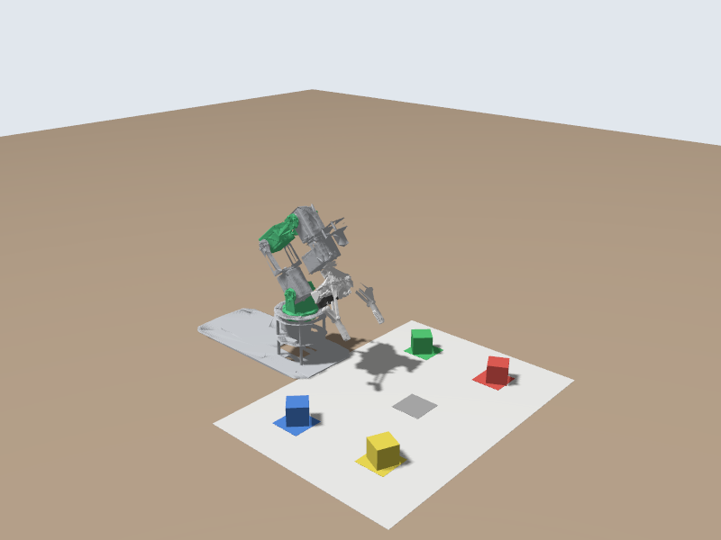
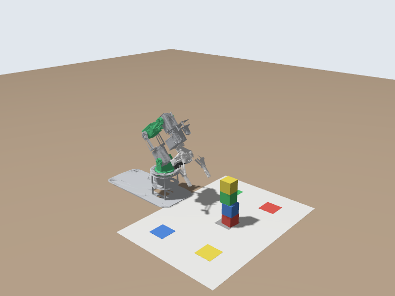

# 🏆 Capstone: Sort the Blocks by Colour

📍 **Level:** Intermediate
📚 **Topic:** Putting it together: camera, actions, and a plan

------

## 🎯 The Task

Four blocks are stacked on the grey square, in an order you don't know. Write a node that:

1. **Looks** at the stack with the camera and reads the colours from top to bottom
2. **Sorts** the blocks: takes them off one at a time, top first, and puts each on the square of its own colour
3. As an extra challenge, **rebuilds** the stack afterwards, in the original order



Everything you need, you have already written: the colour detection of module 12 and the arm and gripper actions of module 10. This module is about combining them into a reliable program.

------

## 🧠 The Plan: Sense, Plan, Act, Check

```
SENSE   move to the look pose, read the stack:   [blue, yellow, red, green]
PLAN    top block = level 4, next = level 3, ...
ACT     for each block: carry(stack level -> its colour square)
CHECK   after every grasp: is there really a block in the gripper?
```

### 🧱 Levels

The block on top of a 4-block stack is at **level 4**, the bottom one at **level 1**. Each level needs its own arm pose, because the block is at a different height. If the camera sees only 3 blocks, the top one is at level 3.

| Level | Gripper pose `at` (servo degrees) |
|---|---|
| 4 (top) | `[90, 72, 49, 14, 270]` |
| 3 | `[90, 68, 41, 20, 270]` |
| 2 | `[90, 63, 32, 30, 270]` |
| 1 (bottom) | `[90, 53, 32, 35, 270]` |

------

## 🆕 Three New Ideas

### ⬇️ 1. Come down vertically

In module 10, the arm swung from high above the stack straight into the grasp pose. That works for the top block, but the open fingers sweep sideways on the way in: near other blocks they can push a block off its square, or knock the stack over.

So every place where a block can be has **two** poses: `over`, 3.5 cm straight above it, and `at`, the gripper around the block. The arm always goes to `over` first, then straight down to `at`, and back up to `over` after grasping or releasing.

```
TRAVEL ─────────────> over
                       │  straight down
                       ▼
                       at   (grasp or release)
                       │  straight up
TRAVEL <───────────── over
```

The `over` poses were computed from Yahboom's `at` poses with the arm's **inverse kinematics** (the maths that turns "gripper here" into joint angles).

### ✋ 2. Grasp carefully, and check the grasp

The gripper closes, opens a little, and closes again. A block that sits at a slight angle gets squared up by the first squeeze, so the second one holds it straight.

A block stops the fingers before they reach the closing position you asked for. If they get all the way there (`result.reached_goal` is true), they closed on **nothing**. The program then stops instead of "placing" air.

### 🔁 3. Steps that stop on failure

```
steps = [lambda: ..., lambda: ..., ...]
return all(step() for step in steps)
```

`all()` runs the steps in order and **stops at the first one that returns False**, the same idea as the step list in module 10, in one line.

------

## 📄 The Code

Create `my_dofbot/scripts/block_sorter.py`. Most of it is code you have already written: the poses, `find_blocks` from module 12, and `run_goal`/`move_arm`/`set_gripper` from module 10. The new parts are `read_stack`, `grasp`, `carry` and `run`.

```
#!/usr/bin/env python3
"""Sort the stack of blocks by colour: read the stack with the camera, then
carry each block to its colour square. With restore:=true, build the stack
again afterwards."""
import math
import time

import cv2
import numpy as np
import rclpy
from builtin_interfaces.msg import Duration
from control_msgs.action import FollowJointTrajectory, GripperCommand
from cv_bridge import CvBridge
from rclpy.action import ActionClient
from rclpy.node import Node
from rclpy.qos import qos_profile_sensor_data
from sensor_msgs.msg import CompressedImage, Image
from trajectory_msgs.msg import JointTrajectoryPoint

JOINTS = ['joint1', 'joint2', 'joint3', 'joint4', 'joint5']

# --- Poses: Yahboom servo angles in degrees (90 = straight), servos 1-5 --------
READY = [90, 130, 0, 0, 90]
LOOK = [90, 135, 15, 0, 90]           # the camera sees the whole stack from the side
TRAVEL = [90, 80, 50, 50, 270]        # high above the stack: the way from one place to another

# Every place where a block can be has two poses:
#   'over': 3.5 cm straight above it, where the gripper comes down from and goes back up to
#   'at':   the gripper around the block, 2 mm above where the block rests
# Coming down vertically keeps the open fingers from pushing the block (or the
# stack) sideways, and letting go just above the surface keeps the block from
# dropping and tipping. The poses were worked out from Yahboom's poses for this
# mat with the arm's inverse kinematics.
STACK = {  # level 1 = the bottom of the stack on the centre square
    4: {'over': [90, 78, 53, 13, 270], 'at': [90, 72, 49, 14, 270]},
    3: {'over': [90, 76, 44, 17, 270], 'at': [90, 68, 41, 20, 270]},
    2: {'over': [90, 74, 32, 26, 270], 'at': [90, 63, 32, 30, 270]},
    1: {'over': [90, 65, 31, 30, 270], 'at': [90, 53, 32, 35, 270]},
}
SQUARES = {  # the four colour squares
    'yellow': {'over': [65, 34, 55, 55, 270], 'at': [65, 22, 60, 58, 270]},
    'red': {'over': [117, 35, 54, 55, 270], 'at': [117, 20, 66, 53, 270]},
    'green': {'over': [136, 76, 24, 20, 270], 'at': [136, 65, 20, 29, 270]},
    'blue': {'over': [44, 78, 21, 21, 270], 'at': [44, 65, 21, 27, 270]},
}
GRIPPER_OPEN = 0.0325    # m, servo 6 at 60 degrees
GRIPPER_BLOCK = 0.0122   # m, servo 6 at 135 degrees: squeezing a 3 cm block
GRIPPER_RESEAT = 0.019   # m, just open enough to let a block turn straight

# --- Colour detection (as in Exercise 7) ---------------------------------------
COLOR_RANGES = {
    'red': [((0, 120, 70), (8, 255, 255)), ((170, 120, 70), (180, 255, 255))],
    'yellow': [((20, 120, 100), (35, 255, 255))],
    'green': [((40, 80, 50), (85, 255, 255))],
    'blue': [((95, 120, 50), (130, 255, 255))],
}
MIN_AREA = 400


def find_blocks(bgr):
    hsv = cv2.cvtColor(bgr, cv2.COLOR_BGR2HSV)
    blocks = []
    for color, ranges in COLOR_RANGES.items():
        mask = np.zeros(hsv.shape[:2], np.uint8)
        for low, high in ranges:
            mask |= cv2.inRange(hsv, np.array(low), np.array(high))
        mask = cv2.morphologyEx(mask, cv2.MORPH_OPEN, np.ones((5, 5), np.uint8))
        contours, _ = cv2.findContours(mask, cv2.RETR_EXTERNAL, cv2.CHAIN_APPROX_SIMPLE)
        for contour in contours:
            if cv2.contourArea(contour) >= MIN_AREA:
                blocks.append((color, *cv2.boundingRect(contour)))
    return blocks


def stack_colors(bgr):
    """Colours of the blocks in the middle third of the picture, top to bottom."""
    width = bgr.shape[1]
    middle = [b for b in find_blocks(bgr) if width / 3 < b[1] + b[3] / 2 < 2 * width / 3]
    return [b[0] for b in sorted(middle, key=lambda b: b[2] + b[4] / 2)]


def servos_to_radians(servo_degrees):
    return [math.radians(d - 90.0) for d in servo_degrees]


class BlockSorter(Node):
    def __init__(self):
        super().__init__('block_sorter')
        self.declare_parameter('image_topic', '/camera/image_raw')
        self.declare_parameter('restore', False)
        self.declare_parameter('check_grasp', True)
        topic = self.get_parameter('image_topic').value

        self.arm = ActionClient(self, FollowJointTrajectory, '/arm_controller/follow_joint_trajectory')
        self.gripper = ActionClient(self, GripperCommand, '/gripper_controller/gripper_cmd')
        self.bridge = CvBridge()
        self.picture = None
        if topic.endswith('/compressed'):
            self.create_subscription(CompressedImage, topic, self.on_compressed, qos_profile_sensor_data)
        else:
            self.create_subscription(Image, topic, self.on_image, qos_profile_sensor_data)

    # --- camera ---------------------------------------------------------------
    def on_image(self, msg):
        self.picture = self.bridge.imgmsg_to_cv2(msg, desired_encoding='bgr8')

    def on_compressed(self, msg):
        self.picture = cv2.imdecode(np.frombuffer(msg.data, np.uint8), cv2.IMREAD_COLOR)

    def read_stack(self, timeout=15.0):
        """Wait until three pictures in a row show the same stack, and return it."""
        readings = []
        deadline = time.monotonic() + timeout
        while time.monotonic() < deadline:
            self.picture = None
            while self.picture is None and time.monotonic() < deadline:
                rclpy.spin_once(self, timeout_sec=0.1)
            if self.picture is None:
                break
            readings.append(stack_colors(self.picture))
            if len(readings) >= 3 and readings[-1] == readings[-2] == readings[-3]:
                return readings[-1]
        self.get_logger().error('No steady picture of the stack. Is the camera running?')
        return None

    # --- arm and gripper (as in Exercise 5) -------------------------------------
    def run_goal(self, client, goal):
        send_future = client.send_goal_async(goal)
        rclpy.spin_until_future_complete(self, send_future)
        goal_handle = send_future.result()
        if not goal_handle.accepted:
            return None
        result_future = goal_handle.get_result_async()
        rclpy.spin_until_future_complete(self, result_future)
        return result_future.result().result

    def move_arm(self, servo_degrees, seconds=1.5):
        goal = FollowJointTrajectory.Goal()
        goal.trajectory.joint_names = JOINTS
        goal.trajectory.points = [JointTrajectoryPoint(
            positions=servos_to_radians(servo_degrees),
            time_from_start=Duration(sec=int(seconds), nanosec=int(seconds % 1 * 1e9)))]
        result = self.run_goal(self.arm, goal)
        if result is None or result.error_code != FollowJointTrajectory.Result.SUCCESSFUL:
            self.get_logger().error(f'Arm move to {servo_degrees} failed')
            return False
        return True

    def set_gripper(self, opening):
        goal = GripperCommand.Goal()
        goal.command.position = opening
        goal.command.max_effort = 10.0
        return self.run_goal(self.gripper, goal)

    def open_gripper(self):
        return self.set_gripper(GRIPPER_OPEN) is not None

    def grasp(self):
        """Close on a block. In the simulator a block stops the fingers before they
        reach GRIPPER_BLOCK, so if they get there they closed on nothing. The real
        DOFBOT reports where its gripper should be, not where it is, so it always
        "gets there": turn the check off there with check_grasp:=false."""
        # Close, open a little, close again: a block that sits at a slight angle
        # is squared up by the first squeeze, so the second one holds it straight.
        if self.set_gripper(GRIPPER_BLOCK) is None or self.set_gripper(GRIPPER_RESEAT) is None:
            return False
        result = self.set_gripper(GRIPPER_BLOCK)
        if result is None:
            return False
        if self.get_parameter('check_grasp').value and result.reached_goal:
            self.get_logger().error('The gripper closed on nothing: the block is not where expected.')
            self.open_gripper()
            return False
        return True

    def carry(self, source, target):
        """Pick up the block at `source` and put it down at `target` (each a dict with 'over' and 'at')."""
        steps = [
            lambda: self.move_arm(source['over']),
            lambda: self.move_arm(source['at'], 1.0),    # straight down
            lambda: self.grasp(),
            lambda: self.move_arm(source['over'], 1.0),  # straight up
            lambda: self.move_arm(TRAVEL),
            lambda: self.move_arm(target['over']),
            lambda: self.move_arm(target['at'], 1.0),
            lambda: self.open_gripper(),
            lambda: self.move_arm(target['over'], 1.0),
            lambda: self.move_arm(TRAVEL),
        ]
        return all(step() for step in steps)  # all() stops at the first step that fails

    # --- the task -------------------------------------------------------------
    def run(self):
        log = self.get_logger()
        for client, name in [(self.arm, 'arm'), (self.gripper, 'gripper')]:
            if not client.wait_for_server(timeout_sec=10.0):
                log.error(f'The {name} controller is not running. Is the simulator (or robot) on?')
                return False

        log.info('Looking at the stack')
        if not (self.open_gripper() and self.move_arm(READY, 2.0) and self.move_arm(LOOK)):
            return False
        time.sleep(1.0)  # let the camera settle
        stack = self.read_stack()
        if not stack:
            return False
        if len(stack) > 4 or len(set(stack)) != len(stack):
            log.error(f'Expected up to 4 blocks of different colours, saw {stack}')
            return False
        log.info(f'Stack, top to bottom: {stack}')
        if not self.move_arm(TRAVEL):
            return False

        # Sort: the top block is at level len(stack), the bottom one at level 1.
        for index, color in enumerate(stack):
            level = len(stack) - index
            log.info(f'{color}: stack level {level} -> {color} square')
            if not self.carry(STACK[level], SQUARES[color]):
                return False

        if self.get_parameter('restore').value:
            log.info('Building the stack again')
            for level, color in enumerate(reversed(stack), start=1):
                log.info(f'{color}: {color} square -> stack level {level}')
                if not self.carry(SQUARES[color], STACK[level]):
                    return False

        self.move_arm(READY, 2.0)
        log.info('Done')
        return True


def main(args=None):
    rclpy.init(args=args)
    node = BlockSorter()
    try:
        node.run()
    except KeyboardInterrupt:
        pass
    node.destroy_node()
    rclpy.try_shutdown()


if __name__ == '__main__':
    main()
```


------

## 🧠 The New Parts

### 👀 `read_stack`: wait for a steady answer

```
if len(readings) >= 3 and readings[-1] == readings[-2] == readings[-3]:
    return readings[-1]
```

A single picture can be taken while the arm still settles, or catch a reflection. The node accepts the stack only when three pictures in a row agree.

### 🦾 `carry(source, target)`

Ten steps: over the source, down, grasp, up, travel, over the target, down, release, up, travel. It works in both directions: `carry(STACK[level], SQUARES[color])` sorts a block, and `carry(SQUARES[color], STACK[level])` puts it back on the stack.

### 🧮 `run`: from the camera's list to levels

```
for index, color in enumerate(stack):
    level = len(stack) - index
```

`stack` lists colours top to bottom, so the first one (index 0) is at the highest level. Rebuilding goes the other way: bottom block first, `enumerate(reversed(stack), start=1)`.

------

## ▶️ Run It

Add `scripts/block_sorter.py` to `install(PROGRAMS ...)`, `chmod +x`, build and source. Then shuffle the stack and sort it:

```
ros2 run dofbot_bringup dofbot_cmd home
ros2 run dofbot_lab reset_blocks.py --shuffle
ros2 run my_dofbot block_sorter.py
```

```
Stack on the centre square, top to bottom: blue, yellow, red, green
[INFO] [block_sorter]: Looking at the stack
[INFO] [block_sorter]: Stack, top to bottom: ['blue', 'yellow', 'red', 'green']
[INFO] [block_sorter]: blue: stack level 4 -> blue square
[INFO] [block_sorter]: yellow: stack level 3 -> yellow square
[INFO] [block_sorter]: red: stack level 2 -> red square
[INFO] [block_sorter]: green: stack level 1 -> green square
[INFO] [block_sorter]: Done
```

It takes about a minute and a half. Take a snapshot to check every block is on its square.

### 🧱 Extra: rebuild the stack

`-p restore:=true` makes the sorter carry the blocks back and rebuild the stack in the original order:

```
ros2 run dofbot_bringup dofbot_cmd home
ros2 run dofbot_lab reset_blocks.py --shuffle
ros2 run my_dofbot block_sorter.py --ros-args -p restore:=true
```



Stacking is much harder than sorting. Every block lands a millimetre or two away from where it should, and on a stack those errors add up: by the fourth level the top block often lands beside the stack instead of on it. In our tests the full stack was rebuilt about one time in three. Making it reliable is the red challenge below.

`Stuck? Build and run the finished version: colcon build --packages-select exercise_8_block_sorter, source, ros2 run exercise_8_block_sorter block_sorter.py`

------

## 🧪 Extend It

### 🟢 Easy

- Sort a smaller stack: `ros2 run dofbot_lab reset_blocks.py red green blue` builds a stack of three (yellow goes off the mat). Does your sorter pick the top block at the right level?
- Make the arm faster: shorter move times. When does it start to fail?

### 🟡 Medium

- **Retry on a miss**: when `grasp()` fails, go back to `LOOK`, read the stack again, and continue from what is really there
- Put the blocks back in a **different** order than the original: e.g. sorted by colour name

### 🔴 Challenge

- Write it as a **service**: `/sort_blocks` (`std_srvs/srv/Trigger`) that sorts when called and answers with the colours it moved. Why would an **action** be the better choice here? (Hint: it takes a minute, and you might want progress and to cancel it.)
- **Make the rebuild reliable.** Ideas: look at the stack with the camera before each placement and correct the base angle; place more slowly; rebuild with the blocks in a different order. Measure your success rate over 5 runs.

------

## ⚠️ Common Problems

| Problem | Cause |
|---|---|
| `No steady picture of the stack` | The camera isn't publishing, or the stack is partly out of view: check `snapshots/camera.png` in the look pose |
| `Expected up to 4 blocks of different colours` | A colour was detected twice (e.g. a square at the edge of the middle third). Check `exercise_7_camera`'s `detections.png` in the look pose |
| `The gripper closed on nothing` | The block wasn't where expected: knocked over, or not reset. `reset_blocks.py` and run again |
| Blocks dropped on the way | Moves too fast for the grip: make them slower |

------

## 🏁 What You Built

A complete robot task, from perception to action:

- **Sense**: a camera picture, HSV colour detection, a steady reading
- **Plan**: colours → stack levels → target squares
- **Act**: action goals for arm and gripper, approaching from above
- **Check**: verify each grasp, stop on any failure

🎉 Congratulations, you have finished **Part 1 - Simulation**.

------

## 🚀 What's Next?

Everything you wrote runs on the real DOFBOT. **Part 2 - Real Hardware** shows you how to connect to it, what is different about real servos and a real camera, and how to run your capstone on the real arm, safely.
