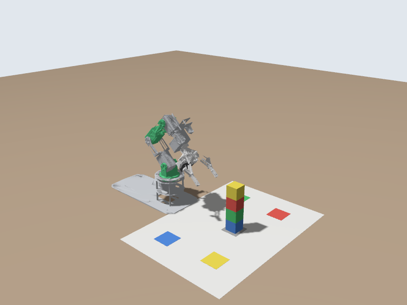
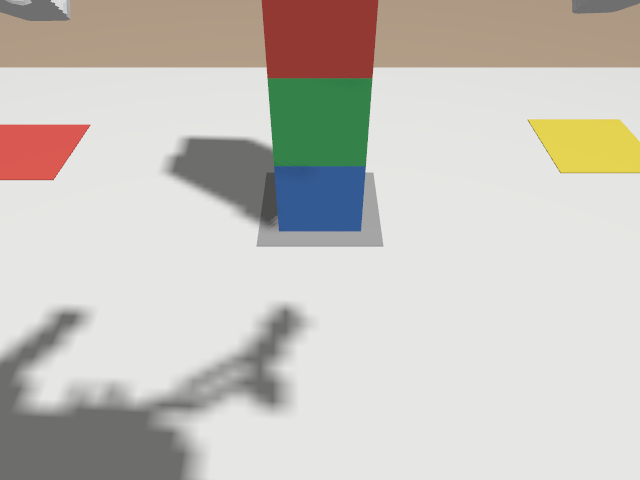
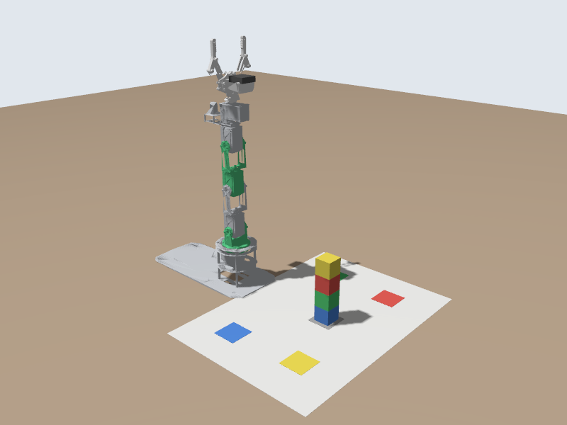

# 🧪 Start the Simulator

📍 **Level:** Absolute beginner
📚 **Topic:** Starting the simulated DOFBOT, looking at it, and moving it with ready-made commands

------

## 🧠 What Is the Simulator?

A **simulator** is a program that pretends to be the robot. It computes how the arm would move under gravity, how the blocks fall and slide, and what the camera would see.

Our simulator is **Gazebo**. It runs inside your console, so you can use it at any time without booking anything.

The important part: the simulated DOFBOT is driven by **exactly the same ROS 2 controllers** as the real one. Your programs can't tell the difference.

```
Your program  ->  arm controller  ->  simulated arm   (Part 1)
Your program  ->  arm controller  ->  real servos     (Part 2)
```

------

## 🎯 Your Goal

You will:

- Build the lab tools (one time)
- Set up your terminal (one time)
- Start the simulator
- Take a picture of the arm
- Move the arm with a ready-made command

------

## 🛠️ Step 1: Build the Lab Tools (one time)

Open a terminal (**Terminal > New Terminal**) and run:

```
cd ~/dofbot_ws
colcon build --packages-select dofbot_lab
```

You should see:

```
Starting >>> dofbot_lab
Finished <<< dofbot_lab [1.5s]

Summary: 1 package finished [1.9s]
```

`Don't worry about what colcon does yet. Module 5 explains building in detail.`

------

## ⚙️ Step 2: Set Up Your Terminal (one time)

Run this once:

```
echo 'source ~/dofbot_ws/src/dofbot_lab/dofbot_env.sh' >> ~/.bashrc
```

`~/.bashrc` is a file that every new terminal runs when it opens. This line makes every new terminal:

- load your workspace, so ROS 2 can find the programs you build
- talk to the **simulator** in your own console (and not to anyone else's)
- show `(sim)` at the start of the prompt, so you always know you are talking to the simulator

Now **close this terminal** (click the bin icon or type `exit`) and **open a new one**. The prompt should start with `(sim)`:

```
(sim) user@5f1c2d9e:~$
```

`If you don't see (sim), run: source ~/.bashrc`

------

## 🚀 Step 3: Start the Simulator

In your terminal, run:

```
ros2 launch dofbot_lab sim.launch.py
```

A lot of text scrolls past. After about 5 to 10 seconds you should see these lines near the end:

```
[spawner_joint_state_broadcaster]: Configured and activated joint_state_broadcaster
[spawner_gripper_controller]: Configured and activated gripper_controller
[spawner_arm_controller]: Configured and activated arm_controller
```

That means the arm is ready.

`Leave this terminal running. The simulator lives as long as this command runs. Closing the terminal or pressing Ctrl + C stops it.`

We will call this terminal **Terminal 1 (simulator)**.

------

## 🔍 Step 4: Check the Controllers

Open a **second terminal** (the **+** button). We will call it **Terminal 2**. Run:

```
ros2 control list_controllers
```

Expected output:

```
joint_state_broadcaster joint_state_broadcaster/JointStateBroadcaster          active
gripper_controller      position_controllers/GripperActionController           active
arm_controller          joint_trajectory_controller/JointTrajectoryController  active
```

| Controller | Job |
|---|---|
| `arm_controller` | Moves the five arm joints along a trajectory you send it |
| `gripper_controller` | Opens and closes the gripper |
| `joint_state_broadcaster` | Publishes where every joint is, many times a second |

------

## 📸 Step 5: Look at the Arm

The simulator runs without a window (it has no screen to draw on in the browser), so we use a camera to look at it. Your lab world has an **overview camera** pointed at the arm and the mat.

In Terminal 2, run:

```
ros2 run dofbot_lab snapshot.py
```

```
[INFO] [snapshot]: Waiting for a picture on /overview_camera/image_raw ...
[INFO] [snapshot]: Saved /home/user/dofbot_ws/src/snapshots/overview_camera.png
```

In the **file explorer**, open the new `snapshots` folder and click `overview_camera.png`:



This is the arm in its start pose, with the stack of blocks on the grey square of the mat.

The arm also has its own camera, near the gripper. Take a picture with it:

```
ros2 run dofbot_lab snapshot.py /camera/image_raw
```

Open `snapshots/camera.png`. This is what the arm sees:



`Tip: the picture does not update by itself. Run the snapshot command again whenever you want a new one.`

------

## 🦾 Step 6: Move the Arm with a Ready-Made Command

`dofbot_cmd` is a small program that comes with the DOFBOT. Try these one at a time in Terminal 2, taking a snapshot after each one:

```
ros2 run dofbot_bringup dofbot_cmd home
```

`home` points the arm straight up. Take a snapshot:



```
ros2 run dofbot_bringup dofbot_cmd ready
```

`ready` is Yahboom's starting pose, with the camera looking down at the mat.

```
ros2 run dofbot_bringup dofbot_cmd close
ros2 run dofbot_bringup dofbot_cmd open
```

These close and open the gripper.

```
ros2 run dofbot_bringup dofbot_cmd state
```

`state` prints where every joint is:

```
joints (rad):   +0.000 +0.698 -1.571 -1.571 +0.000
servos (deg):   90 130 -0 -0 90
gripper (m):    0.0325
```

(`-0` is just 0: a tiny negative number, rounded.) The first line is in **radians**, the unit ROS 2 always uses for angles. `0` on every joint means straight up. The second line is the same pose as **servo angles**, the way the real DOFBOT's servos count (90 = straight). You will meet both again.

| Command | What it does |
|---|---|
| `dofbot_cmd home` | Arm straight up |
| `dofbot_cmd ready` | Yahboom's start pose, camera looking at the mat |
| `dofbot_cmd open` / `close` | Gripper |
| `dofbot_cmd state` | Print the joint angles |
| `dofbot_cmd joints 0.5 0 0 0 0` | Move to these joint angles (radians, joint1 to joint5) |

------

## 🛑 Stopping and Restarting

To stop the simulator, click in Terminal 1 and press `Ctrl + C`. To start it again, run the launch command again.

If the simulator ever behaves strangely, start it fresh. A restart puts the arm and the blocks back where they started:

```
stop_sim
ros2 launch dofbot_lab sim.launch.py
```

`stop_sim` also cleans up simulator programs that `Ctrl + C` left behind. You only need the blocks back without a restart? `ros2 run dofbot_lab reset_blocks.py` stacks them on the grey square again.

------

## ⚠️ Common Problems

| Problem | Fix |
|---|---|
| `Package 'dofbot_lab' not found` | Do Step 1, then open a new terminal (or run `source ~/.bashrc`) |
| The prompt does not show `(sim)` | Do Step 2, then open a new terminal |
| `ros2 control list_controllers` waits and prints nothing | The simulator is not running, or is still starting. Press `Ctrl + C` and check Terminal 1 |
| `No picture arrived on ...` | The simulator is not running |
| `Controller already loaded` errors when starting the simulator | An old simulator is still running in the background. Run `stop_sim`, then start it again |
| `dofbot_cmd` says `arm_controller is not running` | Start the simulator first (Step 3) |

------

## 🏁 What You Learned

- The simulator runs in your own console and uses the same controllers as the real arm
- `ros2 launch dofbot_lab sim.launch.py` starts it; `Ctrl + C` stops it
- `ros2 run dofbot_lab snapshot.py` takes a picture you can open in the file explorer
- `dofbot_cmd` moves the arm to named poses and prints its state
- ROS 2 measures angles in radians; `0` on every joint = straight up

------

## 🚀 What's Next?

`dofbot_cmd` is someone else's program. Next you will move the arm yourself, by sending messages from the command line.
