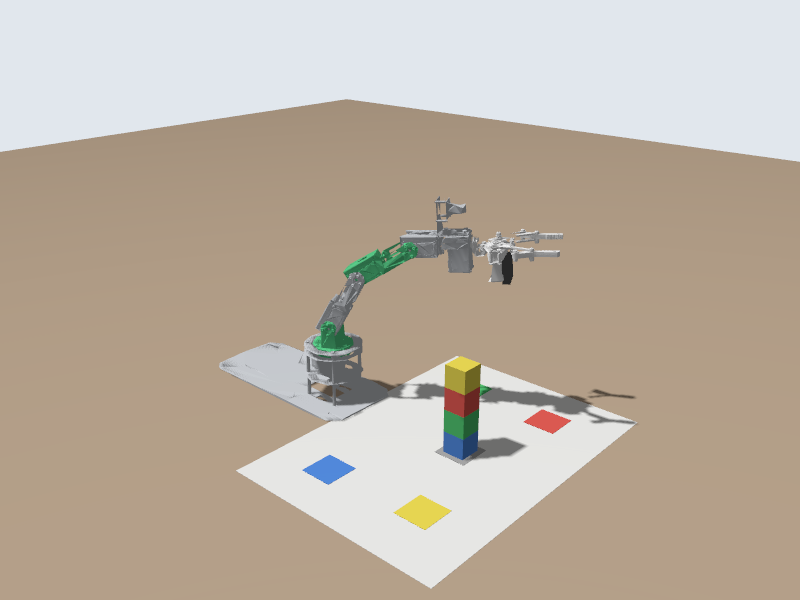

# 🤖 Make the Arm Move

📍 **Level:** Absolute beginner
📚 **Topic:** Sending commands to a robot arm from the command line

------

## 🧠 1. What's Going On Here?

The simulator from module 2 is running and listening for commands. Your goal is simple:

👉 **Send a command → the arm moves → read back where it is**

```
You send a message  ->  arm controller  ->  arm moves  ->  joint states come back
```

`Note: keep the simulator running in Terminal 1 (ros2 launch dofbot_lab sim.launch.py) and type the commands in this module in Terminal 2.`

------

## 📡 2. The Robot's Channels (Topics)

Programs in ROS 2 talk to each other over named channels called **topics**. List them:

```
ros2 topic list
```

```
/arm_controller/controller_state
/arm_controller/joint_trajectory
/arm_controller/state
/camera/camera_info
/camera/image_raw
/clock
/dynamic_joint_states
/joint_states
/overview_camera/image_raw
/parameter_events
/robot_description
/rosout
/tf
/tf_static
...
```

For now, two of them matter:

| Topic | Direction | What it carries |
|---|---|---|
| `/arm_controller/joint_trajectory` | you → arm | Where the joints should go, and how long to take |
| `/joint_states` | arm → you | Where every joint is right now |

You will learn exactly what topics are in module 4.

------

## ⚙️ 3. How a Movement Command Looks

The arm controller takes a message of type **JointTrajectory**: a list of joint names, and one or more **points** saying where those joints should be and when.

```
joint_names: [joint1]                 <- which joints
points:
  - positions: [0.5]                  <- where (radians, one number per joint)
    time_from_start: {sec: 2}         <- arrive 2 seconds from now
```

Angles are in **radians**: `0` is straight, `1.57` is a quarter turn (90°), `0.5` is about 29°.

| Joint | Positive angle | Negative angle |
|---|---|---|
| `joint1` (base) | turns left | turns right |
| `joint2` (shoulder) | leans back | leans forward, towards the mat |
| `joint3` (elbow) | bends back | bends forward |
| `joint4` (wrist) | tilts back | tilts forward |
| `joint5` (wrist roll) | turns the gripper one way | the other way |

`Note: don't get lost in the syntax. Copy the commands exactly; the following modules explain every part.`

------

## 🦾 4. Your First Command

First put the arm straight up, so every move starts from the same place:

```
ros2 run dofbot_bringup dofbot_cmd home
```

### ▶️ Turn the base to the left

```
ros2 topic pub --once /arm_controller/joint_trajectory trajectory_msgs/msg/JointTrajectory "{joint_names: [joint1], points: [{positions: [0.5], time_from_start: {sec: 2}}]}"
```

```
Waiting for at least 1 matching subscription(s)...
publisher: beginning loop
publishing #1: trajectory_msgs.msg.JointTrajectory(...)
```

`--once` waits until the arm controller is listening, sends one message, and stops. The arm takes 2 seconds to get there.

### ▶️ Lean forward

Now send all five joints at once: lean the shoulder, elbow and wrist forward.

```
ros2 topic pub --once /arm_controller/joint_trajectory trajectory_msgs/msg/JointTrajectory "{joint_names: [joint1, joint2, joint3, joint4, joint5], points: [{positions: [0.5, -0.5, -0.5, -0.5, 0.0], time_from_start: {sec: 3}}]}"
```

Take a snapshot and open `snapshots/overview_camera.png`:

```
ros2 run dofbot_lab snapshot.py
```



### ▶️ Back to straight up

```
ros2 topic pub --once /arm_controller/joint_trajectory trajectory_msgs/msg/JointTrajectory "{joint_names: [joint1, joint2, joint3, joint4, joint5], points: [{positions: [0.0, 0.0, 0.0, 0.0, 0.0], time_from_start: {sec: 3}}]}"
```

------

## 👀 5. See Where the Arm Is

Now **listen** to the arm. Print one message from `/joint_states`:

```
ros2 topic echo /joint_states --once
```

```
header:
  stamp:
    sec: 54
    nanosec: 760000000
  frame_id: base_link
name:
- joint2
- joint3
- joint1
- joint4
- joint5
- finger_left_joint
position:
- 7.74859365386752e-13
- 2.3946496926299027e-12
- 2.478078785740592e-13
- 4.2657659268917953e-13
- -7.612825169267504e-15
- 0.032500000000000265
velocity:
- ...
effort:
- .nan
- ...
```

`name` and `position` go together: the first name belongs to the first position, and so on. Notice that the order is **joint2, joint3, joint1**, ...: never assume `position[0]` is `joint1`. All five arm joints are (almost exactly) 0: straight up (`7.7e-13` means 0.00000000000077). The last one is the gripper: each finger is 32.5 mm from the centre, fully open. `effort` is `.nan` (not a number): the arm doesn't measure force.

To watch the numbers change **while** the arm moves, leave this running:

```
ros2 topic echo /joint_states --field position
```

```
array('d', [9.1e-13, 2.7e-12, 9.7e-16, 6.9e-13, -7.6e-15, 0.0325])
---
```

and in a **third terminal** send the "turn left" command again: the third number (`joint1`) changes. Press `Ctrl + C` to stop the echo.

------

## ✋ 6. The Gripper

The gripper does not listen on a topic. It uses an **action**: a command that takes time and reports back when it is done. You will learn actions in module 10; for now, just send one.

Close the gripper:

```
ros2 action send_goal /gripper_controller/gripper_cmd control_msgs/action/GripperCommand "{command: {position: 0.0, max_effort: 10.0}}"
```

```
Waiting for an action server to become available...
Sending goal:
     command:
  position: 0.0
  max_effort: 10.0

Goal accepted with ID: daa9e9a8c641406aa7ed320253547f96

Result:
    position: 0.0019559657552664397
effort: 10.0
stalled: false
reached_goal: true

Goal finished with status: SUCCEEDED
```

The fingers stopped 2 mm from the centre: close enough to count as `reached_goal`.

Open it again (`position` is the distance of each finger from the centre, in metres; 0.0325 is fully open):

```
ros2 action send_goal /gripper_controller/gripper_cmd control_msgs/action/GripperCommand "{command: {position: 0.0325, max_effort: 10.0}}"
```

Notice the difference from the topic: the command **waits** until the gripper has finished and then tells you whether it worked.

------

## 🔄 7. What Just Happened

```
ros2 topic pub  ->  /arm_controller/joint_trajectory  ->  arm_controller  ->  arm moves
                                                                                  |
ros2 topic echo <-  /joint_states  <-  joint_state_broadcaster  <-  joint positions
```

------

## 🧪 8. Try It Yourself

### 🟢 Easy

- Turn the base to the right instead (`-0.5`)
- Make the same move faster (`sec: 1`) and slower (`sec: 5`)

### 🟡 Medium

- Make the arm point at the red square (front left) and then the yellow one (front right). Hint: turn `joint1`, then lean forward with `joint2`.
- Half-close the gripper (`position: 0.015`)

### 🔴 Challenge

- Send a trajectory with **two points**: turn left by 2 s, then right by 4 s. Hint: `points: [{...}, {...}]`, and the second point's `time_from_start` is measured from the start too.

------

## ⚠️ Common Mistakes

| Problem | Cause |
|---|---|
| The command runs but nothing moves | A typo in the topic or joint name: a trajectory with an unknown joint name is rejected as a whole. Copy the names from `ros2 topic echo /joint_states --once` |
| `ros2 topic pub --once` never finishes | Nothing is listening on that topic (wrong name, or the simulator is not running). Press `Ctrl + C` and check `ros2 topic list` |
| The arm jumps instead of moving smoothly | `time_from_start` is missing or 0. Always give the arm time |
| `The passed message type is invalid` | A typo in `trajectory_msgs/msg/JointTrajectory` |

------

## 🏁 9. What You Learned

- Robots are controlled by **sending messages** and observed by **reading messages**
- `/arm_controller/joint_trajectory` moves the arm; `/joint_states` tells you where it is
- Angles are in radians, `0` = straight up
- The gripper is controlled with an **action**, which reports when it has finished

------

## 🚀 What's Next?

You have been typing every command by hand. Before writing programs that do it for you, the next module explains the ideas behind what you just used: nodes, topics, messages, services and actions.
