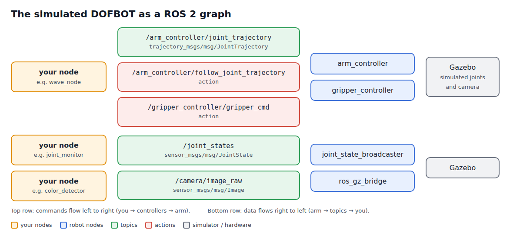
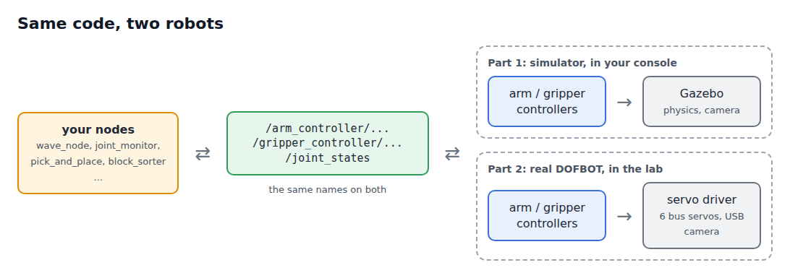

# 🏗️ ROS 2 Architecture

📍 **Level:** Beginner
📚 **Topic:** Nodes, topics, messages, services and actions, seen on the DOFBOT

------

## 🧠 1. Before We Start

In module 3 you moved the arm and read its joints, using words like *topic*, *message* and *action* without defining them. This module defines them, using the DOFBOT that is running in your simulator as the example.

`Keep the simulator running (Terminal 1) and try every command in Terminal 2 as you read.`

------

## 🏗️ 2. What Is ROS 2?

**ROS 2** (Robot Operating System 2) is not an operating system. It is a set of tools and libraries that let many small programs run together on a robot and talk to each other.

A robot needs many jobs done at the same time: read the joint sensors, move the motors, read the camera, decide what to do. In ROS 2 each job is a separate small program, and ROS 2 delivers the messages between them.

```
camera program  ---- picture ---->  your program  ---- "move here" ---->  arm controller
                                          ^                                    |
                                          +------- "joints are here" ----------+
```

------

## 🧱 3. The Building Blocks

| Block | One-line definition | DOFBOT example |
|---|---|---|
| **Node** | A running program with one job | `arm_controller` |
| **Topic** | A named channel for a stream of messages | `/joint_states` |
| **Message** | One piece of data with a fixed structure (a type) | `sensor_msgs/msg/JointState` |
| **Publisher** | A node sending messages on a topic | `joint_state_broadcaster` on `/joint_states` |
| **Subscriber** | A node receiving messages from a topic | `robot_state_publisher` on `/joint_states` |
| **Service** | A question and an answer | `/controller_manager/list_controllers` |
| **Action** | A long task with progress reports and a final result | `/arm_controller/follow_joint_trajectory` |
| **Package** | A folder of code that ROS 2 can build and run | `dofbot_lab` |
| **Workspace** | A folder holding your packages | `~/dofbot_ws` |

------

## 🤖 4. Nodes

A **node** is a running program that does one job. List the nodes of the simulator:

```
ros2 node list
```

```
/arm_controller
/controller_manager
/gripper_controller
/gz_ros2_control
/joint_state_broadcaster
/robot_state_publisher
/ros_gz_bridge
```

| Node | Its one job |
|---|---|
| `/controller_manager` | Loads the controllers and runs them 100 times a second |
| `/arm_controller` | Moves the five arm joints along trajectories |
| `/gripper_controller` | Opens and closes the gripper |
| `/joint_state_broadcaster` | Publishes the joint positions |
| `/robot_state_publisher` | Works out where every part of the arm is in space (for `/tf`) |
| `/ros_gz_bridge` | Passes the clock and camera pictures from Gazebo to ROS 2 |

Ask a node what it publishes and subscribes to:

```
ros2 node info /arm_controller
```

```
/arm_controller
  Subscribers:
    /arm_controller/joint_trajectory: trajectory_msgs/msg/JointTrajectory
    ...
  Publishers:
    /arm_controller/controller_state: control_msgs/msg/JointTrajectoryControllerState
    ...
  Action Servers:
    /arm_controller/follow_joint_trajectory: control_msgs/action/FollowJointTrajectory
```

### 🔑 The ROS 2 Way

Many small nodes, each doing one job, instead of one giant program. If the camera node crashes, the arm still works. On the real robot, the same `arm_controller` runs, but behind it is a real servo driver instead of Gazebo.

------

## 📡 5. Topics

A **topic** is a named channel. Any node can **publish** (send) messages on it, and any number of nodes can **subscribe** (receive). They don't know about each other; they only agree on the topic name and the message type.



Look at a topic:

```
ros2 topic info /joint_states
```

```
Type: sensor_msgs/msg/JointState
Publisher count: 1
Subscription count: 1
```

How often does it arrive?

```
ros2 topic hz /joint_states
```

```
average rate: 88.110
```

About 100 times a second (a busy simulator manages a little less).

`Press Ctrl + C to stop ros2 topic hz.`

Topics are the right tool for **continuous streams** of data that nobody needs to acknowledge: joint positions, camera pictures.

------

## 📦 6. Messages

Every topic carries exactly **one message type**, and every message of that type has the same fields. Show the fields of the joint states message:

```
ros2 interface show sensor_msgs/msg/JointState
```

```
std_msgs/Header header
string[] name
float64[] position
float64[] velocity
float64[] effort
```

(The real output also has comments explaining each field.)

| Field | Meaning |
|---|---|
| `header` | When the measurement was taken |
| `name` | The joint names |
| `position` | The angle of each joint (radians), in the same order as `name` |
| `velocity` | How fast each joint is moving |
| `effort` | The force on each joint (may be empty) |

`Important: name[0] belongs to position[0], name[1] to position[1], and so on. The order is not joint1, joint2, ...: the DOFBOT lists joint2 first. Always match by name.`

And the message you sent to move the arm:

```
ros2 interface show trajectory_msgs/msg/JointTrajectory
```

```
std_msgs/Header header
string[] joint_names
JointTrajectoryPoint[] points
	float64[] positions
	float64[] velocities
	float64[] accelerations
	float64[] effort
	builtin_interfaces/Duration time_from_start
		int32 sec
		uint32 nanosec
```

A message can contain other messages: `points` is a list of `JointTrajectoryPoint`, and each point holds the positions plus a `time_from_start`. That is exactly the structure you typed in module 3:

```
{joint_names: [joint1], points: [{positions: [0.5], time_from_start: {sec: 2}}]}
```

------

## 🙋 7. Services

A **service** is a question with an answer. A client sends a **request**, a server does a short job and sends back a **response**.

The controller manager answers questions about the controllers:

```
ros2 service list | grep controller_manager
```

```
/controller_manager/list_controllers
/controller_manager/load_controller
/controller_manager/switch_controller
...
```

`ros2 control list_controllers`, which you used in module 2, is just a friendly way of calling the `/controller_manager/list_controllers` service.

Services are the right tool for **short jobs where you want an answer**: "which controllers are running?", "save this setting", "is this pose reachable?". You will write your own service in module 9.

------

## 🎯 8. Actions

An **action** is for a **long job**: you send a **goal**, you receive **feedback** while it runs, and a **result** when it ends. You can also cancel it.

```
ros2 action list
```

```
/arm_controller/follow_joint_trajectory
/gripper_controller/gripper_cmd
```

```
ros2 action info /arm_controller/follow_joint_trajectory
```

```
Action: /arm_controller/follow_joint_trajectory
Action clients: 0
Action servers: 1
    /arm_controller
```

Moving a robot arm is the classic action: the move takes seconds, you want to know when it is done (and whether it worked), and you may need to stop it. You used the gripper action in module 3, and you will write an action client in module 10.

------

## ⚖️ 9. Topic, Service or Action?

| | Topic | Service | Action |
|---|---|---|---|
| Shape | One-way stream | Request → response | Goal → feedback... → result |
| Waits for an answer? | No | Yes, a short wait | Yes, and reports progress |
| Can be cancelled? | - | No | Yes |
| DOFBOT example | `/joint_states`, `/camera/image_raw` | `/controller_manager/list_controllers` | `/arm_controller/follow_joint_trajectory` |
| Use it for | Continuous data | Quick questions and settings | Movements and other long tasks |

The arm controller offers **both** a topic (`/arm_controller/joint_trajectory`, fire and forget) and an action (`/arm_controller/follow_joint_trajectory`, with a result). You used the topic in module 3 because it is the simplest. The action is better when your program needs to know that a move has finished before starting the next one, as in pick and place.

------

## 🔄 10. Simulation and Real Robot: the Same Picture



Your nodes only ever talk to the controllers through topics and actions. Below the controllers, either Gazebo or the real servo driver does the work. That is why the code you write in this path runs unchanged on the real arm in Part 2.

------

## ⚠️ 11. Common Confusions

| Confusion | Clarification |
|---|---|
| "A node is a file" | A node is a **running** program. One file can start several nodes, and the same program can run twice under different names |
| "Topics deliver to one receiver" | Every subscriber gets every message |
| "If I publish, someone receives it" | Only if someone has subscribed. A message on a topic nobody listens to is simply lost |
| "Services are for movement" | A service should answer quickly. Movements take seconds: use an action |

------

## 🏁 12. What You Learned

- ROS 2 is many small **nodes** that exchange **messages**
- **Topics** carry streams, **services** answer questions, **actions** run long tasks with feedback
- Every message has a **type** with fixed fields; `ros2 interface show` tells you what they are
- `ros2 node list`, `ros2 topic list/info/echo/hz`, `ros2 service list`, `ros2 action list` let you explore any running robot

------

## 🚀 What's Next?

Time to write code. In the next module you create your own **package** in your workspace, the place where all your programs will live.
