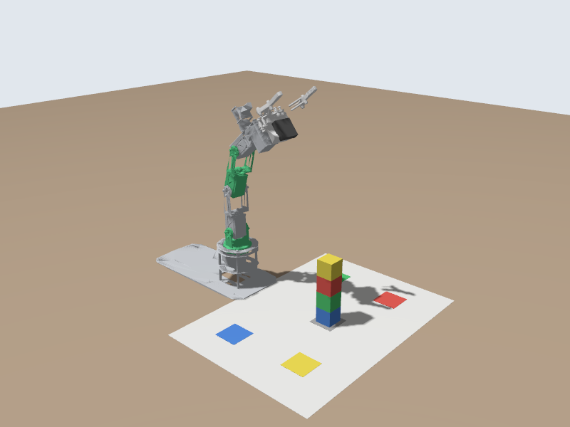

# 👋 Your First Node: Make the Arm Wave

📍 **Level:** Beginner
📚 **Topic:** Publishers, timers, and the JointTrajectory message, in Python

------

## 🧠 What This Node Does

In module 3 you typed one `ros2 topic pub` command per movement. Now you will write a **node** that sends a whole sequence of movements by itself.

The node will:

1. Create a **publisher** on `/arm_controller/joint_trajectory`
2. Create a **timer** that fires every 2.5 seconds
3. Each time the timer fires, publish the next pose of a wave
4. Stop after the last pose

```
timer fires -> next pose -> publish -> arm moves -> (2.5 s later) timer fires -> ...
```

`Start the simulator in Terminal 1 if it isn't running: ros2 launch dofbot_lab sim.launch.py`

------

## 📄 Step 1: Create the File

In the file explorer, right-click `my_dofbot/scripts` and create a new file named `wave_node.py`. Paste this code:

```
#!/usr/bin/env python3
"""Make the DOFBOT wave: publish one pose every 2.5 seconds."""
import rclpy
from builtin_interfaces.msg import Duration
from rclpy.node import Node
from trajectory_msgs.msg import JointTrajectory, JointTrajectoryPoint

# The five arm joints, from the base up. The order must match the numbers in each pose.
JOINTS = ['joint1', 'joint2', 'joint3', 'joint4', 'joint5']

# Poses in radians. 0 on every joint = the arm straight up.
HOME = [0.0, 0.0, 0.0, 0.0, 0.0]
WAVE_LEFT = [0.5, 0.0, -0.3, -0.6, 0.0]    # base turned left, elbow and wrist bent forward
WAVE_RIGHT = [-0.5, 0.0, -0.3, -0.6, 0.0]  # base turned right

POSES = [HOME] + [WAVE_LEFT, WAVE_RIGHT] * 3 + [HOME]

MOVE_TIME = 2.0  # seconds the arm takes to reach each pose
PERIOD = 2.5     # seconds between two commands (a little longer than MOVE_TIME)


class WaveNode(Node):
    def __init__(self):
        super().__init__('wave_node')

        # Publisher: sends JointTrajectory messages to the arm controller.
        self.publisher_ = self.create_publisher(
            JointTrajectory, '/arm_controller/joint_trajectory', 10)

        # Timer: calls timer_callback every PERIOD seconds.
        self.timer = self.create_timer(PERIOD, self.timer_callback)

        self.step = 0  # index of the next pose in POSES

    def timer_callback(self):
        # A message published before the controller has connected is lost.
        if self.publisher_.get_subscription_count() == 0:
            self.get_logger().warn('Waiting for the arm controller to connect...')
            return

        if self.step == len(POSES):
            self.get_logger().info('Done waving. Press Ctrl+C to exit.')
            self.timer.cancel()
            return

        # One trajectory with a single point: "be at these positions MOVE_TIME s from now".
        point = JointTrajectoryPoint()
        point.positions = POSES[self.step]
        point.time_from_start = Duration(sec=int(MOVE_TIME), nanosec=int(MOVE_TIME % 1 * 1e9))

        msg = JointTrajectory()
        msg.joint_names = JOINTS
        msg.points = [point]

        self.publisher_.publish(msg)
        self.get_logger().info(f'Pose {self.step + 1}/{len(POSES)}: {POSES[self.step]}')
        self.step += 1


def main(args=None):
    rclpy.init(args=args)
    node = WaveNode()
    try:
        rclpy.spin(node)
    except KeyboardInterrupt:
        pass
    node.destroy_node()
    rclpy.try_shutdown()


if __name__ == '__main__':
    main()
```

------

## 🧠 Step 2: Understand the Code

### 📦 Imports

```
import rclpy
from rclpy.node import Node
from trajectory_msgs.msg import JointTrajectory, JointTrajectoryPoint
from builtin_interfaces.msg import Duration
```

`rclpy` is the ROS 2 library for Python. The other imports are the **message types** you need: the same `trajectory_msgs/msg/JointTrajectory` you typed in module 3. In Python, `trajectory_msgs/msg/JointTrajectory` becomes `from trajectory_msgs.msg import JointTrajectory`.

### 🤖 The node

```
class WaveNode(Node):
    def __init__(self):
        super().__init__('wave_node')
```

Your node is a Python class built on ROS 2's `Node`. `'wave_node'` is the name `ros2 node list` will show.

### 📤 The publisher

```
self.publisher_ = self.create_publisher(
    JointTrajectory, '/arm_controller/joint_trajectory', 10)
```

Three things: the **message type**, the **topic name**, and a **queue size** (how many messages to keep if they can't be sent right away; 10 is a normal value).

### ⏱️ The timer

```
self.timer = self.create_timer(PERIOD, self.timer_callback)
```

Every `PERIOD` seconds, ROS 2 calls `timer_callback`. A publisher on its own sends nothing; something has to call `publish()`. Here the timer does.

### 🛑 Waiting for the controller

```
if self.publisher_.get_subscription_count() == 0:
```

Right after a node starts, it takes a moment for ROS 2 to connect it to the arm controller. A message published before that moment is lost. The node waits until someone is subscribed.

### 🦾 Building the message

```
point = JointTrajectoryPoint()
point.positions = POSES[self.step]
point.time_from_start = Duration(sec=2, nanosec=0)

msg = JointTrajectory()
msg.joint_names = JOINTS
msg.points = [point]
```

This builds exactly the structure you typed in module 3, `{joint_names: [...], points: [{positions: [...], time_from_start: {sec: 2}}]}`, as Python objects.

### 🔁 spin

```
rclpy.spin(node)
```

`spin` keeps the program alive and calls your callbacks (here, the timer) when they are due. Without it, the node would be created and the program would end immediately.

------

## ⚙️ Step 3: Install, Build, Run

Add the new script to the `install(PROGRAMS ...)` block in `my_dofbot/CMakeLists.txt`:

```
install(PROGRAMS
  scripts/hello_dofbot.py
  scripts/wave_node.py
  DESTINATION lib/${PROJECT_NAME}
)
```

Make it executable, build, source and run (in Terminal 2):

```
chmod +x ~/dofbot_ws/src/my_dofbot/scripts/wave_node.py
cd ~/dofbot_ws
colcon build --packages-select my_dofbot
source install/setup.bash
ros2 run my_dofbot wave_node.py
```

------

## 🎉 What Should Happen

```
[INFO] [wave_node]: Pose 1/8: [0.0, 0.0, 0.0, 0.0, 0.0]
[INFO] [wave_node]: Pose 2/8: [0.5, 0.0, -0.3, -0.6, 0.0]
[INFO] [wave_node]: Pose 3/8: [-0.5, 0.0, -0.3, -0.6, 0.0]
...
[INFO] [wave_node]: Pose 8/8: [0.0, 0.0, 0.0, 0.0, 0.0]
[INFO] [wave_node]: Done waving. Press Ctrl+C to exit.
```

While it runs, take a snapshot in a third terminal (`ros2 run dofbot_lab snapshot.py`) to catch the arm mid-wave:



Press `Ctrl + C` to stop the node.

`Stuck? The finished version is in your workspace: exercise_1_publisher/scripts/wave_node.py. To run it, build it like your own package (colcon build --packages-select exercise_1_publisher, then source install/setup.bash) and run ros2 run exercise_1_publisher wave_node.py`

------

## 🔄 What Just Happened

```
wave_node (your node)
    | publishes JointTrajectory every 2.5 s
    v
/arm_controller/joint_trajectory
    |
    v
arm_controller -> simulated arm moves -> /joint_states
```

------

## 🧪 Try It Yourself

### 🟢 Easy

- Make the wave bigger: change `0.5` to `0.8` in `WAVE_LEFT` and `WAVE_RIGHT`
- Wave 5 times instead of 3

### 🟡 Medium

- Make it wave faster: `MOVE_TIME = 1.0` and `PERIOD = 1.5`. What happens if `PERIOD` is **shorter** than `MOVE_TIME`? (Try `PERIOD = 0.5`, and watch where the arm gets to.)
- Add a "nod" at the end: tilt the wrist (`joint4`) forward and back twice

### 🔴 Challenge

- Send the whole wave as **one** message: a single `JointTrajectory` with 8 points, the first at 2 s, the next at 4 s, and so on. Publish it once and the controller plays all of it. Which version is better, and why?

------

## ⚠️ Common Mistakes

| Problem | Cause |
|---|---|
| `No executable found` | `wave_node.py` is not in `install(PROGRAMS ...)`, or you didn't rebuild |
| The node prints poses but the arm doesn't move | A typo in the topic name or a joint name. Compare with `ros2 topic list` and `ros2 topic echo /joint_states --once` |
| `Waiting for the arm controller to connect...` forever | The simulator isn't running |
| `IndentationError` | Python is strict about spaces. Keep the indentation exactly as shown |
| The arm keeps moving after you stop the node | It finishes the last command it received. To freeze it at once: `ros2 run dofbot_lab stop_arm.py` |

------

## 🎯 What You Learned

- A **publisher** sends messages on a topic; a **timer** decides when
- How to build a `JointTrajectory` message in Python
- Why a node must wait for its subscriber before publishing a one-off command
- `rclpy.spin()` keeps the node alive and runs its callbacks

------

## 🚀 What's Next?

Your node sends commands but never checks where the arm actually is. Next, you will write a **subscriber** that reads the arm's joint states.
