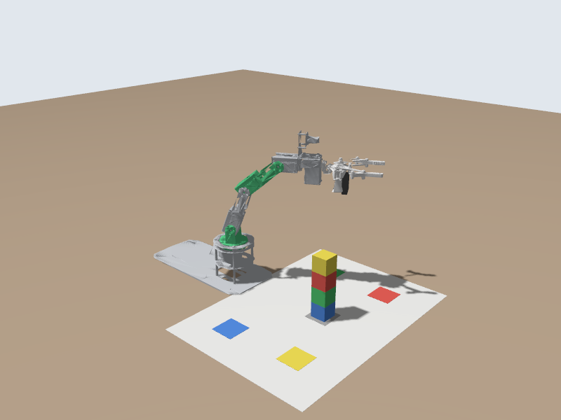

# 🧩 Custom Messages: an Arm Pose in Degrees

📍 **Level:** Intermediate
📚 **Topic:** Designing your own message type, generating it, and using it in a node

------

## 🧠 Why a Custom Message?

To move the arm you have been writing things like:

```
joint_names: [joint1, joint2, joint3, joint4, joint5]
positions: [0.5, -0.35, -0.52, -0.7, 0.0]
```

That is the controller's language: joint names, radians, a separate list for the time. It is easy to get the order wrong, and nobody thinks in radians.

People would rather say: *"base 30°, shoulder -20°, elbow -30°, wrist -40°, in 2 seconds"*.

You can make ROS 2 speak that language by designing your own **message type**. In this module you will:

1. Define a message `ArmPose` with one field per joint, in degrees
2. Let ROS 2 generate the Python and C++ code for it
3. Write a node that listens for `ArmPose` messages and turns them into trajectories for the arm

```
you --(ArmPose, degrees)--> /arm_pose --> pose_commander --(JointTrajectory, radians)--> arm_controller
```

------

## 🧩 Step 1: Design the Message

A message file lists fields, one per line: a **type** and a **name**.

| Field | Type | Meaning |
|---|---|---|
| `base` | `float64` | joint1 in degrees: + turns left |
| `shoulder` | `float64` | joint2: - leans forward |
| `elbow` | `float64` | joint3: - bends forward |
| `wrist` | `float64` | joint4: - bends forward |
| `roll` | `float64` | joint5: turns the gripper |
| `seconds` | `float64` | how long the move should take |

`float64` is a decimal number. Other common types are `int32` (whole numbers), `bool` (true/false), `string` (text), and lists such as `float64[]`.

------

## 📁 Step 2: Create the Message File

Message files live in a `msg` folder and their names start with a capital letter:

```
mkdir -p ~/dofbot_ws/src/my_dofbot/msg
```

Create `my_dofbot/msg/ArmPose.msg` in the file explorer and paste:

```
# A pose for the DOFBOT arm, in degrees. 0 on every joint = the arm straight up.
float64 base       # joint1: + turns left, - turns right       (-90 .. 90)
float64 shoulder   # joint2: - leans forward (towards the mat)  (-90 .. 90)
float64 elbow      # joint3: - bends forward                    (-90 .. 90)
float64 wrist      # joint4: - bends forward                    (-90 .. 90)
float64 roll       # joint5: turns the gripper                  (-90 .. 180)
float64 seconds    # how long the move should take
```

`#` starts a comment, as in Python.

------

## ⚙️ Step 3: Tell the Build About It

ROS 2 turns `.msg` files into code with a tool called **rosidl**. Two files need to know.

### 📄 package.xml

Open `my_dofbot/package.xml` and add these three lines after `<buildtool_depend>ament_cmake</buildtool_depend>`:

```
<buildtool_depend>rosidl_default_generators</buildtool_depend>
<exec_depend>rosidl_default_runtime</exec_depend>
<member_of_group>rosidl_interface_packages</member_of_group>
```

### 📄 CMakeLists.txt

Open `my_dofbot/CMakeLists.txt`. Below `find_package(ament_cmake REQUIRED)` add:

```
find_package(rosidl_default_generators REQUIRED)

rosidl_generate_interfaces(${PROJECT_NAME}
  "msg/ArmPose.msg"
)
ament_export_dependencies(rosidl_default_runtime)
```

------

## 🏗️ Step 4: Build and Check

```
cd ~/dofbot_ws
colcon build --packages-select my_dofbot
source install/setup.bash
ros2 interface show my_dofbot/msg/ArmPose
```

```
# A pose for the DOFBOT arm, in degrees. 0 on every joint = the arm straight up.
float64 base       # joint1: + turns left, - turns right       (-90 .. 90)
float64 shoulder   # joint2: - leans forward (towards the mat)  (-90 .. 90)
...
```

The build takes longer than before (about 10 to 20 seconds): rosidl just generated Python and C++ code for your message. Your message is now a real ROS 2 type, just like `sensor_msgs/msg/JointState`.

You can even try it in Python straight away:

```
python3 -c "from my_dofbot.msg import ArmPose; print(ArmPose(base=30.0, seconds=2.0))"
```

```
my_dofbot.msg.ArmPose(base=30.0, shoulder=0.0, elbow=0.0, wrist=0.0, roll=0.0, seconds=2.0)
```

Fields you don't set are 0.

------

## 📄 Step 5: A Node That Uses It

Create `my_dofbot/scripts/pose_commander.py`:

```
#!/usr/bin/env python3
"""Listen for ArmPose messages (degrees) on /arm_pose and move the arm there."""
import math

import rclpy
from builtin_interfaces.msg import Duration
from rclpy.node import Node
from trajectory_msgs.msg import JointTrajectory, JointTrajectoryPoint

from my_dofbot.msg import ArmPose

JOINTS = ['joint1', 'joint2', 'joint3', 'joint4', 'joint5']
LIMITS_DEG = [(-90, 90), (-90, 90), (-90, 90), (-90, 90), (-90, 180)]
MIN_SECONDS = 1.0  # never rush the arm


class PoseCommander(Node):
    def __init__(self):
        super().__init__('pose_commander')
        self.subscription = self.create_subscription(ArmPose, '/arm_pose', self.on_arm_pose, 10)
        self.publisher_ = self.create_publisher(JointTrajectory, '/arm_controller/joint_trajectory', 10)
        self.get_logger().info('Waiting for ArmPose messages on /arm_pose')

    def on_arm_pose(self, pose):
        requested = [pose.base, pose.shoulder, pose.elbow, pose.wrist, pose.roll]

        # Keep every joint inside its travel, and say so when we had to.
        degrees = []
        for name, value, (low, high) in zip(JOINTS, requested, LIMITS_DEG):
            clamped = min(max(value, low), high)
            if clamped != value:
                self.get_logger().warn(f'{name}: {value:.0f} deg is out of range, using {clamped:.0f}')
            degrees.append(clamped)

        seconds = max(pose.seconds, MIN_SECONDS)

        point = JointTrajectoryPoint()
        point.positions = [math.radians(d) for d in degrees]
        point.time_from_start = Duration(sec=int(seconds), nanosec=int(seconds % 1 * 1e9))

        msg = JointTrajectory()
        msg.joint_names = JOINTS
        msg.points = [point]
        self.publisher_.publish(msg)
        self.get_logger().info(f'Moving to {degrees} deg in {seconds:.1f} s')


def main(args=None):
    rclpy.init(args=args)
    node = PoseCommander()
    try:
        rclpy.spin(node)
    except KeyboardInterrupt:
        pass
    node.destroy_node()
    rclpy.try_shutdown()


if __name__ == '__main__':
    main()
```

The node is a **translator**: it subscribes to `/arm_pose`, checks each value against the joint's limits, converts degrees to radians, and publishes a `JointTrajectory`. It is also a **safety layer**: whatever anyone sends, the arm never gets a target outside its travel, and never a move faster than one second.

------

## ▶️ Step 6: Build and Run

Add `scripts/pose_commander.py` to `install(PROGRAMS ...)`, then:

```
chmod +x ~/dofbot_ws/src/my_dofbot/scripts/pose_commander.py
cd ~/dofbot_ws
colcon build --packages-select my_dofbot
source install/setup.bash
ros2 run my_dofbot pose_commander.py
```

In another terminal, send a pose:

```
ros2 topic pub --once /arm_pose my_dofbot/msg/ArmPose "{base: 30.0, shoulder: -20.0, elbow: -30.0, wrist: -40.0, roll: 0.0, seconds: 2.0}"
```

```
[INFO] [pose_commander]: Moving to [30.0, -20.0, -30.0, -40.0, 0.0] deg in 2.0 s
```



Now try sending something out of range:

```
ros2 topic pub --once /arm_pose my_dofbot/msg/ArmPose "{base: 120.0, seconds: 0.2}"
```

```
[WARN] [pose_commander]: joint1: 120 deg is out of range, using 90
[INFO] [pose_commander]: Moving to [90, 0.0, 0.0, 0.0, 0.0] deg in 1.0 s
```

`Stuck? The finished version is the exercise_3_custom_message package (build it with colcon build --packages-select exercise_3_custom_message and source): ros2 run exercise_3_custom_message pose_commander.py, with the type exercise_3_custom_message/msg/ArmPose.`

------

## 🧠 What Happened at Build Time?

When you built, rosidl read `ArmPose.msg` and generated:

- a Python class (`from my_dofbot.msg import ArmPose`)
- a C++ class (`my_dofbot::msg::ArmPose`, in `my_dofbot/msg/arm_pose.hpp`)
- the code that turns an `ArmPose` into bytes and back, so it can travel between nodes, even between a Python node and a C++ node, or between your console and the real robot

------

## 🧪 Try It Yourself

### 🟢 Easy

- Point the arm at each colour square in turn with `ros2 topic pub`

### 🟡 Medium

- Add a field `bool gripper_open` to `ArmPose` (rebuild!). Print it in the node. (Moving the gripper needs an action: module 10.)

### 🔴 Challenge

- Write a second node, `pose_sequence.py`, that publishes a list of `ArmPose` messages to `/arm_pose` one after another, so `pose_commander` performs a small dance.

------

## ⚠️ Common Mistakes

| Problem | Cause |
|---|---|
| `ModuleNotFoundError: No module named 'my_dofbot.msg'` | You didn't rebuild after adding the message, or didn't source |
| Build error `rosidl_generate_interfaces ... not found` | `find_package(rosidl_default_generators REQUIRED)` is missing |
| Build error about `member_of_group` | The three `package.xml` lines are missing or misplaced |
| `The passed message type is invalid` | Type written wrong on the command line: it is `my_dofbot/msg/ArmPose` |
| Message file not found | The file must be `msg/ArmPose.msg`: capital A and P, inside `msg/` |

------

## 🎯 What You Learned

- A `.msg` file defines a message type: one `type name` per line
- `rosidl_generate_interfaces` in `CMakeLists.txt` plus three lines in `package.xml` turn it into code
- `ros2 interface show` proves it exists
- A node can translate between a friendly message and the robot's own, and protect the robot while doing it

------

## 🚀 What's Next?

`pose_commander` reacts to anything published on `/arm_pose`, but the sender never hears back whether its pose was accepted. Next you will use a **service**: a request that gets an answer.
