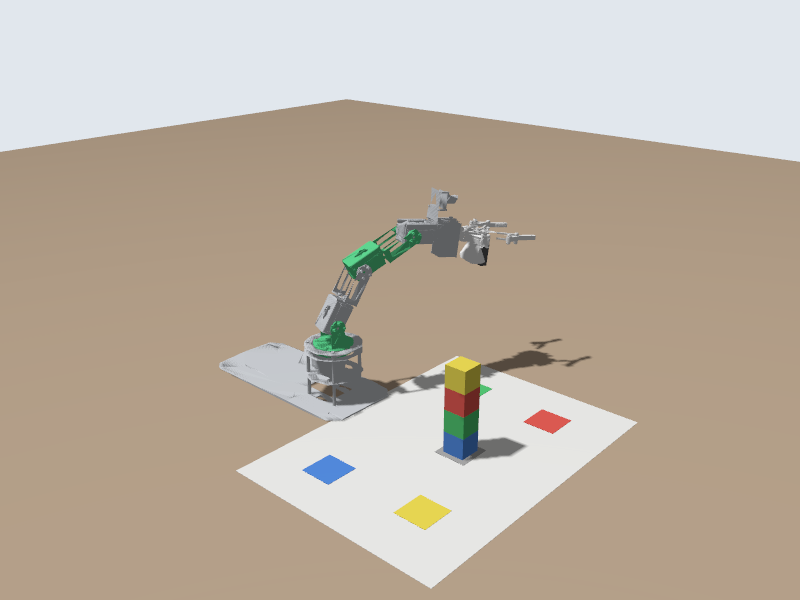

# 🙋 Services: Move to a Pose by Name

📍 **Level:** Intermediate
📚 **Topic:** Service definitions, service servers and service clients

------

## 🧠 Topics vs Services

When you publish an `ArmPose`, you never learn what happened. Was the pose valid? Did anyone receive it?

A **service** is a request that always gets a **response**:

```
client --(request: "go to ready")--> server
client <--(response: success, "Moving to ready")-- server
```

| | Topic | Service |
|---|---|---|
| Direction | One way | Request and response |
| Receivers | Any number | Exactly one server |
| The sender knows the result? | No | Yes |
| Good for | Streams of data | Short jobs and questions |

In this module you write a service that moves the arm to a **named pose**: `home`, `ready`, `look`, `left` or `right`, and answers whether it knew that name.

------

## 🧩 Step 1: Define the Service

A service definition is like a message, in two parts separated by `---`: the **request** above, the **response** below.

Create `my_dofbot/srv/MoveToNamedPose.srv`:

```
mkdir -p ~/dofbot_ws/src/my_dofbot/srv
```

```
# Request: the name of a pose the server knows, and how long the move should take
string name
float64 seconds
---
# Response: whether the pose was found and sent to the arm, and a message for people
bool success
string message
```

Add it to the `rosidl_generate_interfaces` block in `CMakeLists.txt`, next to your message:

```
rosidl_generate_interfaces(${PROJECT_NAME}
  "msg/ArmPose.msg"
  "srv/MoveToNamedPose.srv"
)
```

Build and check:

```
cd ~/dofbot_ws
colcon build --packages-select my_dofbot
source install/setup.bash
ros2 interface show my_dofbot/srv/MoveToNamedPose
```

------

## 🖥️ Step 2: The Service Server

Create `my_dofbot/scripts/named_pose_server.py`:

```
#!/usr/bin/env python3
"""Offer /move_to_named_pose: move the arm to a pose by name, and answer whether it worked."""
import rclpy
from builtin_interfaces.msg import Duration
from rclpy.node import Node
from trajectory_msgs.msg import JointTrajectory, JointTrajectoryPoint

from my_dofbot.srv import MoveToNamedPose

JOINTS = ['joint1', 'joint2', 'joint3', 'joint4', 'joint5']

# Named poses in radians (0 everywhere = straight up).
POSES = {
    'home': [0.0, 0.0, 0.0, 0.0, 0.0],             # straight up
    'ready': [0.0, 0.698, -1.571, -1.571, 0.0],    # camera looking at the mat (Yahboom's start pose)
    'look': [0.0, 0.785, -1.309, -1.571, 0.0],     # camera looking at the block stack
    'left': [1.2, -0.5, -0.6, -0.6, 0.0],          # leaning out to the left
    'right': [-1.2, -0.5, -0.6, -0.6, 0.0],        # leaning out to the right
}


class NamedPoseServer(Node):
    def __init__(self):
        super().__init__('named_pose_server')
        self.publisher_ = self.create_publisher(JointTrajectory, '/arm_controller/joint_trajectory', 10)
        self.service = self.create_service(MoveToNamedPose, '/move_to_named_pose', self.handle_request)
        self.get_logger().info(f'Ready. Known poses: {", ".join(POSES)}')

    def handle_request(self, request, response):
        if request.name not in POSES:
            response.success = False
            response.message = f'Unknown pose "{request.name}". Known poses: {", ".join(POSES)}'
            self.get_logger().warn(response.message)
            return response

        seconds = max(request.seconds, 1.0)
        point = JointTrajectoryPoint()
        point.positions = POSES[request.name]
        point.time_from_start = Duration(sec=int(seconds), nanosec=int(seconds % 1 * 1e9))
        msg = JointTrajectory()
        msg.joint_names = JOINTS
        msg.points = [point]
        self.publisher_.publish(msg)

        response.success = True
        response.message = f'Moving to "{request.name}" in {seconds:.1f} s'
        self.get_logger().info(response.message)
        return response


def main(args=None):
    rclpy.init(args=args)
    node = NamedPoseServer()
    try:
        rclpy.spin(node)
    except KeyboardInterrupt:
        pass
    node.destroy_node()
    rclpy.try_shutdown()


if __name__ == '__main__':
    main()
```

### 🧠 How it works

```
self.service = self.create_service(MoveToNamedPose, '/move_to_named_pose', self.handle_request)
```

Like a subscriber, but for a service: the **type**, the **name**, and the **callback**. ROS 2 calls `handle_request(request, response)` for each request; your job is to fill in `response` and return it.

------

## 📞 Step 3: Call It from the Command Line

Add `scripts/named_pose_server.py` to `install(PROGRAMS ...)`, `chmod +x` it, build, source, and start the server:

```
ros2 run my_dofbot named_pose_server.py
```

```
[INFO] [named_pose_server]: Ready. Known poses: home, ready, look, left, right
```

In another terminal:

```
ros2 service list | grep named
ros2 service call /move_to_named_pose my_dofbot/srv/MoveToNamedPose "{name: left, seconds: 2.0}"
```

```
requester: making request: my_dofbot.srv.MoveToNamedPose_Request(name='left', seconds=2.0)

response:
my_dofbot.srv.MoveToNamedPose_Response(success=True, message='Moving to "left" in 2.0 s')
```



And a name it doesn't know:

```
ros2 service call /move_to_named_pose my_dofbot/srv/MoveToNamedPose "{name: dance, seconds: 2.0}"
```

```
response:
my_dofbot.srv.MoveToNamedPose_Response(success=False, message='Unknown pose "dance". Known poses: home, ready, look, left, right')
```

That is the difference from a topic: the caller **knows** it failed, and why.

------

## 💻 Step 4: Call It from Code (a Service Client)

Create `my_dofbot/scripts/named_pose_client.py`:

```
#!/usr/bin/env python3
"""Call /move_to_named_pose. Usage: named_pose_client.py <pose name> [seconds]"""
import sys

import rclpy
from rclpy.node import Node

from my_dofbot.srv import MoveToNamedPose


def main():
    args = rclpy.utilities.remove_ros_args(sys.argv)[1:]
    if not args:
        print('Usage: ros2 run my_dofbot named_pose_client.py <pose name> [seconds]')
        return 1

    rclpy.init()
    node = Node('named_pose_client')
    client = node.create_client(MoveToNamedPose, '/move_to_named_pose')

    if not client.wait_for_service(timeout_sec=5.0):
        node.get_logger().error('/move_to_named_pose is not available. Start named_pose_server.py first.')
        rclpy.try_shutdown()
        return 1

    request = MoveToNamedPose.Request()
    request.name = args[0]
    request.seconds = float(args[1]) if len(args) > 1 else 2.0

    future = client.call_async(request)             # send the request...
    rclpy.spin_until_future_complete(node, future)  # ...and wait for the answer
    response = future.result()

    if response.success:
        node.get_logger().info(response.message)
    else:
        node.get_logger().error(response.message)

    node.destroy_node()
    rclpy.try_shutdown()
    return 0 if response.success else 1


if __name__ == '__main__':
    sys.exit(main())
```

### 🧠 How it works

| Line | What it does |
|---|---|
| `create_client(MoveToNamedPose, '/move_to_named_pose')` | Makes a client for that service |
| `wait_for_service(timeout_sec=5.0)` | Waits until a server exists. Without a server, a request would wait forever |
| `call_async(request)` | Sends the request and returns a **future**: a box the answer will arrive in |
| `spin_until_future_complete(node, future)` | Spins the node until the answer is in the box |

Install it, build, source, and run (with the server still running):

```
ros2 run my_dofbot named_pose_client.py ready
ros2 run my_dofbot named_pose_client.py look 3.0
ros2 run my_dofbot named_pose_client.py home
```

`Stuck? The finished versions are in exercise_4_service (type exercise_4_service/srv/MoveToNamedPose). Build it with colcon build --packages-select exercise_4_service and source before running it.`

------

## ⚠️ A Limit of This Service

The server answers **immediately**, as soon as it has **sent** the pose: "Moving to ready". It doesn't know when the arm **arrives**, or whether it got there. A service should answer quickly, and an arm move takes seconds. For "tell me when the move has finished, and how it went", ROS 2 has **actions**: the next module.

------

## 🧪 Try It Yourself

### 🟢 Easy

- Add a pose `wave` to `POSES`

### 🟡 Medium

- Add a second service, `/list_named_poses`, of type `std_srvs/srv/Trigger` (no request fields; the response has `success` and `message`), that answers with the names of all poses. Test it with `ros2 service call /list_named_poses std_srvs/srv/Trigger`.

### 🔴 Challenge

- Let the client take several names (`named_pose_client.py ready look home`) and call the service for each, waiting the requested time between them.

------

## ⚠️ Common Mistakes

| Problem | Cause |
|---|---|
| `waiting for service to become available...` forever | The server isn't running, or the service name has a typo |
| `ModuleNotFoundError: No module named 'my_dofbot.srv'` | The `.srv` file is not in `rosidl_generate_interfaces`, or you didn't rebuild and source |
| The server crashes with `TypeError` | `handle_request` must **return** the response |
| The client hangs | You used `client.call()` (blocking) inside a running node. Use `call_async` + `spin_until_future_complete` as shown |

------

## 🎯 What You Learned

- A `.srv` file defines a request and a response, separated by `---`
- A **server** answers with a callback; a **client** sends a request and waits for the future
- `ros2 service list` and `ros2 service call` test a service without writing a client
- Services are for quick answers; long movements need actions

------

## 🚀 What's Next?

In the next module you will use **actions** to move the arm and the gripper step by step, waiting for each move to finish: enough to pick up a block and put it down somewhere else.
