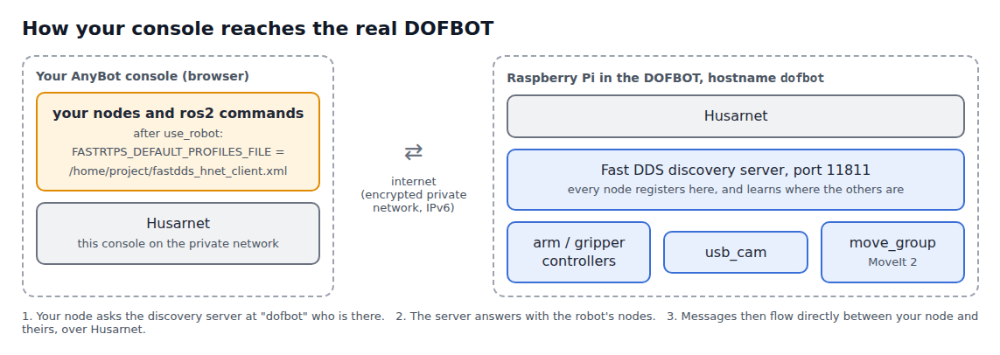

# 🔌 Connecting to the Real DOFBOT

📍 **Level:** Intermediate
📚 **Topic:** Switching your terminals from the simulator to the real robot, and how the connection works

------

## 🧠 What Changes When You Connect

In Part 1, every `ros2` command in your console talked to the simulator, inside your own console. Now your commands have to reach a Raspberry Pi in our lab.

You don't need to change any code. You only switch **who your terminal talks to**:

| Command | Your terminal talks to | Prompt |
|---|---|---|
| `use_sim` | The simulator in your console | `(sim) user@...$` |
| `use_robot` | The real DOFBOT | `(ROBOT) user@...$` |

These commands come from `dofbot_lab/dofbot_env.sh`, which you added to `~/.bashrc` in Part 1, module 2. If your prompt doesn't start with `(sim)` or `(ROBOT)`, do that step first.

------

## 🔌 Step 1: Connect

Start your **booked session** and open a terminal. Then:

```
use_robot
```

```
This terminal now talks to the REAL DOFBOT (new terminals too).
Your commands move real hardware: watch the arm.
```

The prompt changes:

```
(ROBOT) user@5f1c2d9e:~$
```

The choice is remembered: **new** terminals you open also talk to the robot. Terminals that were already open keep their old setting until you run `use_robot` in them too. **Always check the prompt before you run anything.**

If you get this instead:

```
The real DOFBOT is not reachable from this console.
```

you are in a preview session (the robot is only connected during a booked one), or your session has only just started. Wait a minute and try again; if it keeps failing, tell your instructor.

------

## 🔍 Step 2: Check That You See the Robot

These commands only **read**. They are always safe.

```
ros2 node list
```

```
/arm_controller
/controller_manager
/gripper_controller
/joint_state_broadcaster
/move_group
/moveit_simple_controller_manager
/robot_state_publisher
/usb_cam/usb_cam
...
```

Compare with the simulator's list from Part 1, module 4: the same controllers, plus two newcomers:

| Node | What it is |
|---|---|
| `/usb_cam/usb_cam` | The driver of the real USB camera |
| `/move_group` | MoveIt 2, the motion planner, running on the robot |

There is no `/ros_gz_bridge` or `/gz_ros2_control`: no Gazebo here.

```
ros2 control list_controllers
```

```
arm_controller          joint_trajectory_controller/JointTrajectoryController  active
gripper_controller      position_controllers/GripperActionController           active
joint_state_broadcaster joint_state_broadcaster/JointStateBroadcaster          active
```

```
ros2 topic list | grep -E "joint|usb_cam"
```

```
/arm_controller/joint_trajectory
/joint_states
/usb_cam/camera_info
/usb_cam/image_raw
/usb_cam/image_raw/compressed
...
```

And where is the arm right now?

```
ros2 run dofbot_bringup dofbot_cmd state
```

```
joints (rad):   -1.571 +0.473 +0.000 +0.000 +0.000
servos (deg):   0 117 90 90 90
gripper (m):    0.0003
```

(Your numbers will differ: the arm is wherever the last person left it.) Look at the **Robot Video Feed** and check that the arm matches what `state` says. Now you know your console and the real arm agree.

------

## 🌐 How the Connection Works



Two pieces make your console and the robot one ROS 2 system across the internet:

| Piece | What it does |
|---|---|
| **Husarnet** | A private network (a VPN) between your console and the robot. On it, the robot is simply called `dofbot` |
| **Fast DDS discovery server** | Normally ROS 2 nodes find each other by shouting on the local network, which doesn't work across the internet. The robot runs a **discovery server**; every node asks it "who else is there?" |

`use_robot` sets one variable, `FASTRTPS_DEFAULT_PROFILES_FILE`, to a file that tells ROS 2 "use the discovery server at `dofbot`, over Husarnet". `use_sim` removes it again and keeps ROS 2 inside your console (`ROS_LOCALHOST_ONLY=1`).

You can see the setting:

```
echo $FASTRTPS_DEFAULT_PROFILES_FILE
```

```
/home/project/fastdds_hnet_client.xml
```

------

## 🔁 Switching Back

To go back to the simulator (for example to test a change during your slot):

```
use_sim
```

Your simulator still works during a booked session, with its own private ROS 2 network. Two terminals can even talk to different targets: one `(sim)`, one `(ROBOT)`. Only the prompt tells them apart, so **look at the prompt**.

`Tip: at the end of your slot, run use_sim, so your next preview session starts on the simulator.`

------

## ⚠️ Troubleshooting

| Problem | Cause and fix |
|---|---|
| `The real DOFBOT is not reachable` | Not in a booked session, or the connection isn't up yet. Wait a minute; then ask your instructor |
| `ros2 node list` shows nothing | Run `ros2 daemon stop`, then try again. Still nothing: the robot may be off. Tell your instructor |
| `ros2 topic list` shows topics but `echo` prints nothing | Wait 5-10 s: the first messages across the internet take a moment. For camera topics use `/compressed` (module 5) |
| A new terminal shows `(sim)` during your slot | It was opened before `use_robot`, or the robot wasn't reachable when it opened. Run `use_robot` in it |
| Commands are slower than in the simulator | Normal: every message crosses the internet |

------

## 🎯 What You Learned

- `use_robot` / `use_sim` switch your terminals between the real arm and the simulator; the prompt shows which
- The real arm has the same controllers, topics and actions, plus a USB camera and MoveIt 2
- Husarnet connects your console and the robot; a Fast DDS discovery server lets ROS 2 nodes find each other across it
- Read-only commands (`list`, `echo`, `state`) are always safe; check the arm on the video feed

------

## 🚀 What's Next?

You are connected. Next: the safety routine, and your first moves on real servos.
