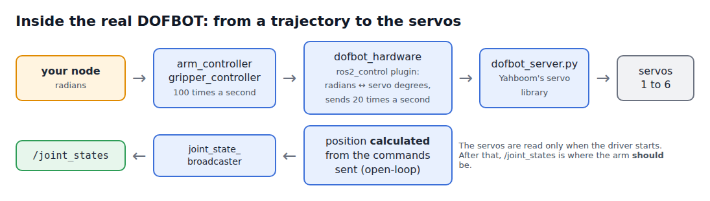

# 📐 Joint States and Servo Angles

📍 **Level:** Intermediate
📚 **Topic:** How the real DOFBOT reports its joints, and how ROS 2 angles map to servo angles

------

## 🧠 From ROS 2 to Servos

In the simulator, Gazebo moved the joints. On the real DOFBOT, the same controller commands are passed down to six **bus servos**:



| Layer | What it does |
|---|---|
| `arm_controller`, `gripper_controller` | The same controllers as in the simulator: they turn your trajectory into a target for every joint, 100 times a second |
| `dofbot_hardware` (ros2_control plugin) | Converts joint angles in radians into servo angles in degrees, and sends them 20 times a second |
| `dofbot_server.py` | Talks to the servos through Yahboom's library |
| Servos 1-6 | Move to the angles they are sent |

Because the conversion happens below the controllers, your code always works in radians, exactly as in Part 1.

### ⚠️ The joint states are calculated, not measured

Reading six servos over their bus takes far longer than the 100 updates a second the controllers want. So the driver reads the servos **once**, when it starts, and from then on **calculates** where each servo should be from the commands it has sent and how fast the servos move. That is what `/joint_states` reports. This is called **open-loop** state.

It means: if the arm is blocked (by a block, the table, or a hand), `/joint_states` does **not** show it. It shows where the arm should be. On the real arm, **your eyes on the video feed are the sensor of last resort.**

------

## 📡 Step 1: Real Joint States

With your terminal on `(ROBOT)`:

```
ros2 topic echo /joint_states --once
```

```
header:
  stamp:
    sec: 1791786570
    nanosec: 51821371
  frame_id: base_link
name:
- joint2
- joint3
- joint1
- joint4
- joint5
- finger_left_joint
position:
- 0.473
- 0.0
- -1.5707963
- 0.0
- 0.0
- 0.0002708
velocity:
- 0.0
- 0.0
- 0.0
- 0.0
- 0.0
- 0.0
effort:
- .nan
- .nan
- .nan
- .nan
- .nan
- .nan
```

The same as in the simulator: the joint order (**joint2, joint3, joint1**, ...: match names, as your joint monitor does) and `effort` (`nan`: check with `math.isnan` before using it). The differences:

| | Simulator | Real DOFBOT | What it means for your code |
|---|---|---|---|
| `position` | Simulated | Calculated from the commands (open-loop) | It shows where the arm should be, not where it is |
| `velocity` | Simulated | Calculated, 0 when the arm should be still | Same: a blocked arm still shows the planned speed |
| `stamp` | Simulation time (seconds since the simulator started) | Real time (seconds since 1970) | Compare stamps only with stamps from the same robot |

------

## 🔢 Step 2: Radians and Servo Angles

The DOFBOT's servos count in **degrees**, with 90° in the middle. ROS 2 counts in **radians**, with 0 in the middle. Yahboom's own programs, and the poses in their tutorials, use servo degrees.

| Joint | Servo | Servo range | ROS 2 range | Conversion |
|---|---|---|---|---|
| `joint1` (base) | 1 | 0° to 180° | -π/2 to π/2 | `rad = (deg - 90) × π / 180` |
| `joint2` (shoulder) | 2 | 0° to 180° | -π/2 to π/2 | same |
| `joint3` (elbow) | 3 | 0° to 180° | -π/2 to π/2 | same |
| `joint4` (wrist) | 4 | 0° to 180° | -π/2 to π/2 | same |
| `joint5` (roll) | 5 | 0° to 270° | -π/2 to π | same |
| `finger_left_joint` (gripper) | 6 | 60° (open) to 180° (closed) | 0.0325 m to 0 m | `m = (180 - deg) × 0.0325 / 120` |

Examples:

| Servo angles | Radians | Pose |
|---|---|---|
| `[90, 90, 90, 90, 90]` | `[0, 0, 0, 0, 0]` | Straight up (`home`) |
| `[90, 130, 0, 0, 90]` | `[0, 0.698, -1.571, -1.571, 0]` | `ready` |
| gripper 135° | 0.0122 m | Holding a 3 cm block |

`dofbot_cmd state` prints both, so you can check the conversion on the real arm:

```
ros2 run dofbot_bringup dofbot_cmd state
```

```
joints (rad):   +0.000 +0.698 -1.571 -1.571 +0.000
servos (deg):   90 130 0 0 90
gripper (m):    0.0325
```

And it can move by servo angles directly:

```
ros2 run dofbot_bringup dofbot_cmd -t 3 servos 90 120 30 30 90
```

------

## 👀 Step 3: Your Joint Monitor on the Real Arm

Run the subscriber you wrote in Part 1, module 7 (or the reference one), unchanged:

```
ros2 run my_dofbot joint_monitor.py
```

```
[INFO] [joint_monitor]: base    0.0 | shoulder   30.0 | elbow  -60.0 | wrist  -60.0 | roll    0.0 | gripper 32.5 mm
```

It works on the real arm exactly as in the simulator, because it matches joints **by name**. A node that used `msg.position[0]` for the base would print the shoulder instead, on both.

The C++ version from module 11 works too: `ros2 run my_dofbot_cpp joint_monitor`.

------

## 🔎 Step 4: Numbers and Reality

Send a pose, then read it back:

```
ros2 run dofbot_bringup dofbot_cmd -t 3 servos 90 120 30 30 90
ros2 run dofbot_bringup dofbot_cmd state
```

`state` shows exactly `90 120 30 30 90`: the driver reports what it calculated, not what it measured. The real arm is close to that pose, but not exactly on it: a servo stops when it is close enough, and gravity pulls the arm a little. A degree at the shoulder moves the gripper by about 4 mm.

The same goes for the gripper. Closing on a block, the real fingers stop on the block, but `/joint_states` (and the gripper action's result) report that they reached the closing position. In the simulator, the gripper result told you whether a block was in the gripper (Part 1, module 10). **On the real arm it can't.**

This is why, on the real arm, you check results with your eyes (the video feed) and with real sensors like the camera, and not only with the numbers the arm reports.

------

## 🧪 Try It Yourself

### 🟢 Easy

- Convert `[90, 80, 50, 50, 270]` (the pose above the stack from Part 1, module 10) to radians by hand, then check with `dofbot_cmd -t 3 servos 90 80 50 50 270` and `dofbot_cmd state`

### 🟡 Medium

- Extend your joint monitor to print each joint as a **servo angle** too
- Print a warning when `/joint_states` stops arriving for more than a second (save the time of the last message in the callback; check it in the timer)

### 🔴 Challenge

- Measure the real accuracy of `joint1` with the **camera**: point the camera at the mat from the `ready` pose, take a snapshot, turn the base to 100° and back to 90° from the left, snapshot, then from the right, snapshot. Do the three pictures line up? A difference between coming from the left and from the right is called **backlash**.

------

## 🎯 What You Learned

- Under the same controllers, the real arm converts radians to servo degrees and back
- Its positions are **calculated** from the commands (open-loop), not measured: a blocked arm or a block in the gripper doesn't show
- `rad = (deg - 90) × π / 180` for joints 1-5; the gripper maps servo 60°-180° to 32.5-0 mm

------

## 🚀 What's Next?

Now run the rest of your Part 1 programs on the real arm: the wave, the pose commander, the named-pose service, and pick and place.
